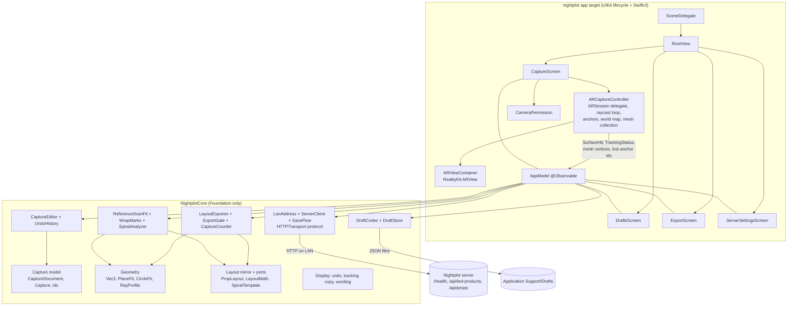
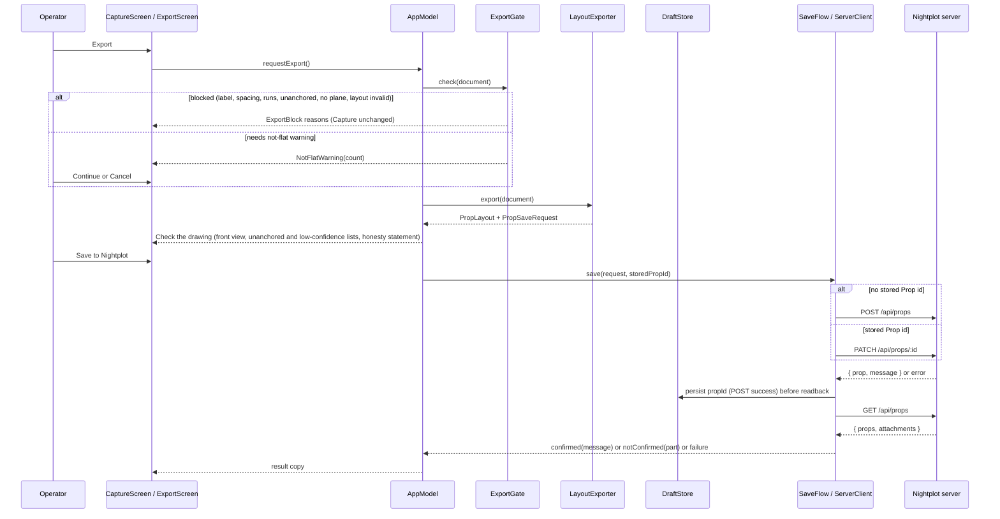
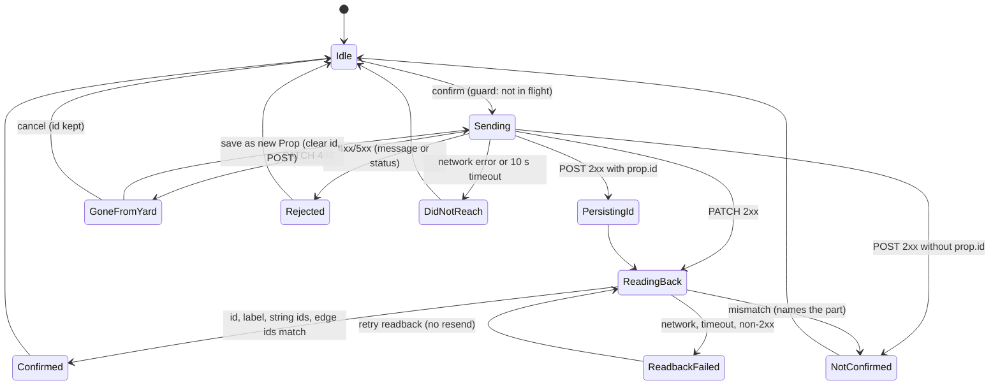

# Design Document: iOS AR Prop Capture

## Overview

Nightplot Capture is an iOS 17+ app in `ios/nightplot` that measures a real object with ARKit and saves it to the Nightplot server as a **Prop** design. The app has two layers:

1. **NightplotCore**, a local Swift package at `ios/NightplotCore`. It holds every rule that can be stated without a camera: the Capture model and its edits, undo, id allocation, projection-plane fitting, `PropLayout` export, light counting, spiral analysis, the draft JSON codec, the LAN address check, and the server client. It imports Foundation only. It never imports ARKit, RealityKit, AVFoundation, or UIKit (Req 1.7).
2. **The `nightplot` app target**, which owns the ARKit session, the RealityKit view, camera permission, SwiftUI screens, and file locations. It turns ARKit callbacks into plain values (`SurfaceHit`, `TrackingStatus`, mesh vertices) and hands them to NightplotCore.

The app does not invent a parallel model. NightplotCore holds a Swift `Codable` mirror of `PropLayout` from `packages/shared/src/prop/layout.ts`, and Swift ports of the functions the requirements name: `isPropLayout`, `edgeLengthM`, `drawnLengthM`, `countLayout` (including its wrap counting), `lightsOnLength`, `formatLength`, `parsePitchCm`, `formatPitchCm`, `spiralLengthM` and `spiralLayout` from `wraps.ts`, and `isLanAllowed` from `net/address.ts`. Parity with the TypeScript originals is checked from both sides against committed JSON files (see Testing Strategy).

Saving is `POST /api/props` or `PATCH /api/props/:id`, then a `GET /api/props` readback that compares the label and the string and edge ids. A save is reported as confirmed only when the readback matches. The app writes nothing to any WLED controller, and its copy says so (Req 15).

The feature changes the server in one place. `apps/server` gets a `LightsStore` interface and an `InMemoryLightsStore`, so the fixture test and a shared behaviour suite can run `createApp` without a lights file (Req 14.10, 14.11). The running server still uses `FileLightsStore`, and its behaviour does not change.

### Findings from the existing code

These facts shaped the design:

| Finding | Source | Consequence |
| --- | --- | --- |
| The Xcode project uses the Xcode 27.2 text project format (`nightplot.xcodeproj/project.xcproj`) with folder-synchronised groups. The folders `nightplot`, `nightplotTests`, and `nightplotUITests` are members of their targets. | `project.xcproj` | New Swift files dropped into those folders join the right target with no project edit. The local package and the PropertyBased dependency are added through Xcode's package UI so the project file stays valid. |
| `IPHONEOS_DEPLOYMENT_TARGET` is `27.2` at project level and on `nightplotTests`. | `project.xcproj` | Set to `17.0` at project level and remove the target overrides (Req 1.2). |
| `INFOPLIST_KEY_UIRequiredDeviceCapabilities` is `arkit`. | `project.xcproj` | Remove it. With it, iOS refuses to install on a device without ARKit, so Req 1.3 (open drafts on such a device) can never run. |
| `INFOPLIST_KEY_NSCameraUsageDescription` is the placeholder `CAMERA_USAGE_DESCRIPTION`. | `project.xcproj` | Replace with real text (Req 2.1). Add `INFOPLIST_KEY_NSLocalNetworkUsageDescription` (Req 11.4). |
| `ContentView` uses `RealityView` with `content.camera = .spatialTracking`. | `ContentView.swift` | On iOS, `RealityView` with an AR camera needs iOS 18 ([RealityKit notes](https://github.com/Nagarjuna2997/ios-agent-skill/blob/main/docs/frameworks/realitykit.md)). With an iOS 17 floor the app uses RealityKit's `ARView` in a `UIViewRepresentable`. `ARView` also exposes the `ARSession` directly, which raycasts, scene reconstruction, anchors, and world maps need. |
| The app uses a UIKit `AppDelegate` and `SceneDelegate` that host SwiftUI through `UIHostingController`. | `AppDelegate.swift`, `SceneDelegate.swift` | Keep them. `SceneDelegate` builds the app environment and hosts `RootView`. Foreground return is observed with `UIApplication.didBecomeActiveNotification`, which works under UIKit lifecycle (Req 2.6). |
| The app target sets `SWIFT_DEFAULT_ACTOR_ISOLATION = MainActor`. | `project.xcproj` | NightplotCore is a separate module in Swift 6 language mode with no default isolation. Its types are `Sendable` value types, so they are usable from main-actor UI code and from background tasks. |
| `ios/` is untracked in the parent repo and `ios/nightplot/.git` is a separate repository with one commit (`4cc4013 Initial Commit`). The root `.gitignore` has no Xcode or SwiftPM entries. | `git status`, `git -C ios/nightplot log`, `.gitignore` | Committing `ios/` as-is would embed a nested repository. The nested `.git` is removed after a backup, and Xcode entries are added to `.gitignore` (Req 1.9, see Recorded decisions). |
| `AppDeps.store` in `app.ts` is typed as the concrete `FileLightsStore`. `LookRouteDeps`, `SyncRouteDeps`, `PropSetupDeps`, `persistWireframeOnLight`, `renameProp`, `yardFrom`, and two `Pick<FileLightsStore, …>` helpers use the same concrete type. | `app.ts`, `look-routes.ts`, `sync-routes.ts`, `prop-setup-routes.ts`, `wireframe-persist.ts` | A `LightsStore` interface replaces the concrete type in all of them, so `createApp` accepts an in-memory store (Req 14.10). |
| `store.path` is read in three places: the backup restore route (`writeNightplotStoresConsistent`), the season restore route (`writeSeasonStoresConsistent`), and `createApp`'s `FileYardUndoStore` file, placed at `dirname(deps.store.path)`. | `app.ts`, `season-routes.ts` | The two restore routes write the lights file directly, so they cannot restore into memory. They refuse with a clear error when the store has no path. The yard undo file falls back to a temp file, the same way `createApp` already defaults its other optional stores. |
| `countLayout` counts runs of consecutive wrapped lit edges (those with `wrapLengthM`) along the whole chain. Each edge's count is `lightsOnLength(end) − lightsOnLength(start)` along the chain. A wire, hidden, or unwrapped edge restarts the chain. | `wrapCounts` in `layout.ts` | With Req 8.7 at 1e−9 m, almost every lit edge of a real Capture carries `wrapLengthM`, so consecutive lit runs are counted as one chain. The app's displayed counts must use the same chain rule (Req 7.13). |
| Server `POST /api/props` trims the label and keeps `slice(0, 64)`, which counts UTF-16 code units. | `prop-setup-routes.ts` | The app measures the 64 limit in UTF-16 code units (`label.utf16.count`). Counting Swift `Character`s would let an emoji label pass in the app, get cut by the server, and then fail the label readback. |
| `PATCH /api/props/:id` reads `label`, `kind`, `layout`, `measurements`, `sections`, and `shapeRoles`. It keeps `existing.design.ledProductId` and takes spacing from `layout.pitchM`. | `prop-setup-routes.ts` | PATCH sends the four fields Req 12.3 lists. A changed LED product after the first save does not reach the server through PATCH. This is a server limitation, noted in Error Handling, not worked around. |
| `GET /api/props` returns `{ props, attachments }`. `/health` returns `{ ok, service: "nightplot-configure", slice }`. `GET /api/led-products` returns `{ products }`. | `app.ts`, `prop-setup-routes.ts` | Wire types below. |
| JavaScript `Math.round` rounds halves toward +∞ (`Math.round(-2.5) === -2`). Swift `rounded()` rounds halves away from zero. | language semantics | Every ported rounding uses `jsRound(x) = (x + 0.5).rounded(.down)`. The parity vectors include half-way and negative cases. |
| ATS does not apply to IP-address hosts. `NSAllowsLocalNetworking` admits `.local` and unqualified names. `isLanAllowed` also admits `.lan`, `.home.arpa`, and `.internal`. | [Apple forums on ATS and IPs](https://developer.apple.com/forums/thread/66417) | `Info.plist` sets `NSAllowsLocalNetworking` and adds exception domains `lan`, `home.arpa`, and `internal` with insecure HTTP allowed. Whether ATS honours a top-level exception domain must be checked on a device. If it does not, those hosts fail as "could not connect", which is honest. |
| [PropertyBased](https://github.com/x-sheep/swift-property-based) is a Swift 6 property-testing library for Swift Testing. It supports composable generators, shrinking, custom iteration counts, and `.fixedSeed(...)` to replay a failure. | GitHub README | Chosen PBT library. It runs inside the existing `nightplotTests` Swift Testing target. |

Content from external sources was rephrased for compliance with licensing restrictions.

### Design decisions

- **One core package, one test target.** NightplotCore is a single library target with folders per area. Its tests live in `nightplotTests`, as Req 1.7 requires, and import `NightplotCore`. Splitting the core into several packages would add build plumbing without a second consumer.
- **Ids follow the web editor.** Capture_Points use `c<n>`, Capture_Runs use `e<n>`, Capture_Strings use `s<n>`. A Capture_Point id becomes its `LayoutCorner` id, and a Capture_Run id becomes its `LayoutEdge` id, with no mapping table. `retiredIds` is shared with the layout as-is.
- **Undo stores whole snapshots.** A Capture is a small value. Keeping up to 100 snapshots costs little memory and makes the undo round trip (Req 6.4) true by construction.
- **State that is not an edit lives outside the snapshot.** Id high-water marks, lost-anchor records, the stored Prop id, the Flat option, and the spiral state (Reference_Scan and Wrap_Marks) are not in the Req 6.1 list of edits. They sit next to the undoable `Capture` in a `CaptureDocument`, so Undo cannot roll them back.
- **Anchoring is tracked by anchor id, not by a flag on the point.** Each placement or Move gives the point a fresh `anchorId`, and the ARKit anchor is named with it. When the session loses anchors, their ids go into the document's `lostAnchorIds`. A point is unanchored when its current `anchorId` is in that set. Moving it gives a new id, so it becomes anchored (Req 15.6). Undoing that Move restores the lost id, so the point is unanchored again, which is correct.
- **Two export paths.** A trace Capture exports by projection (Req 8). An accepted spiral exports from the Spiral_Analyzer (Req 10.6, 10.7). The run-count block in Req 8.15 applies to the trace path only, because a spiral Capture may have no Capture_Strings at all.
- **The front-on check screen is not called "Preview".** Req 15.2 bars the word Preview from anything that describes saving. The screen is titled "Check the drawing", and the confirm control is "Save to Nightplot".

### Recorded decisions

- **`ios/` becomes ordinary files in the main repository (Req 1.9).** The nested `ios/nightplot/.git` is removed, with no submodule. The step is:
  1. Check the nested repository for uncommitted work with `git -C ios/nightplot status --porcelain`. Removing `.git` keeps the working files either way, but the check shows what the backup would not hold.
  2. Back up its history outside the main repository, for example `git -C ios/nightplot bundle create ~/Backups/nightplot-ios-history.bundle --all`, and confirm it with `git bundle verify`.
  3. Remove `ios/nightplot/.git`. This deletes the nested history, so it runs only after the backup is verified and with the operator's go-ahead.
  4. Add Xcode and SwiftPM build output to the root `.gitignore`: `xcuserdata/`, `*.xcuserstate`, `DerivedData/`, `.build/`, and `.swiftpm/`. `Package.resolved` stays tracked so package versions are pinned.
  5. Stage `ios/` and check with `git status` that no user data, build output, or `.git` directory is staged.
- **`wrapLengthM` on every lit run that differs from the drawing (Req 8.7, 8.10).** The exporter sets `wrapLengthM` to the 3D length on every lit run whose 3D length differs from its drawn length by more than 1e−9 m. Each lit edge's `edgeLengthM` is then within 1e−9 m of its 3D length, so the total-length rule in Req 8.10 holds.
- **A real in-memory lights store on the server (Req 14.10, 14.11).** `apps/server` gets a `LightsStore` interface, an `InMemoryLightsStore`, and a behaviour test suite that runs against both stores. See component 11.

## Architecture



### Layers and dependency rule

- NightplotCore depends on Foundation only. A source-scan check in the test suite fails if any file under `ios/NightplotCore/Sources` imports `ARKit`, `RealityKit`, `AVFoundation`, `UIKit`, or `SwiftUI`.
- The app target depends on NightplotCore. ARKit types never cross into NightplotCore. `ARCaptureController` converts them at the boundary.
- `AppModel` is the single main-actor owner of the open `CaptureDocument`, its `UndoHistory`, the session-only state (active string, Dark Jump, selection), the server status, and the export flow state.

### Repository layout

```text
ios/
  NightplotCore/
    Package.swift                 # swift-tools-version 6.0; iOS 17, macOS 14
    Sources/NightplotCore/
      Capture/    Capture.swift, CaptureDocument.swift, IdAllocator.swift,
                  CaptureEdit.swift, CaptureEditor.swift, UndoHistory.swift, Proximity.swift
      Geometry/   Vec3.swift, PlaneFit.swift, CircleFit.swift, RayProfile.swift
      Layout/     PropLayout.swift, LayoutMath.swift, LayoutValidation.swift,
                  SpiralTemplate.swift, JSRound.swift
      Export/     ExportGate.swift, LayoutExporter.swift, CaptureCounter.swift
      Spiral/     ReferenceScan.swift, ReferenceScanFit.swift, WrapMarks.swift,
                  SpiralAnalyzer.swift, MeasuredWraps.swift
      Drafts/     DraftCodec.swift, DraftStore.swift, DraftFileSystem.swift
      Net/        LanAddress.swift, ServerAddress.swift, ServerRoute.swift,
                  HTTPTransport.swift, URLSessionTransport.swift, WireTypes.swift,
                  ServerClient.swift, SaveFlow.swift
      Display/    Units.swift, TrackingCopy.swift, Wording.swift, DepthModeChoice.swift
  fixtures/
    prop-layouts/                 # written by Swift tests, read by vitest
    parity/                       # written by vitest, read by Swift tests
  nightplot/                      # existing Xcode project
    nightplot/
      AppDelegate.swift, SceneDelegate.swift, Info.plist
      App/        AppModel.swift, RootView.swift, AppEnvironment.swift
      AR/         ARCaptureController.swift, ARViewContainer.swift, SceneOverlay.swift,
                  MeshCollector.swift, SurfaceHitReader.swift, WorldMapStore.swift
      Screens/    DraftsScreen.swift, CaptureScreen.swift, CaptureDetailsSheet.swift,
                  ReferenceScanFlow.swift, WrapMarkFlow.swift, ExportScreen.swift,
                  FrontViewCanvas.swift, ServerSettingsScreen.swift
      Permissions/CameraPermission.swift
    nightplotTests/               # Swift Testing + PropertyBased, runs on Simulator
    nightplotUITests/

apps/server/src/
  store/
    lights-store.ts               # LightsStore interface, TextLightsStore base, FileLightsStore
    in-memory-lights-store.ts     # InMemoryLightsStore (new)
  prop-routes.store-parity.test.ts   # one behaviour suite, run against both stores (new)
  ios-capture-fixtures.test.ts       # Swift fixtures through createApp + InMemoryLightsStore (new)
packages/shared/src/prop/
  ios-parity.test.ts              # TS-owned parity vectors (new)
```

`ContentView.swift` is removed. Its `RealityView` needs iOS 18.

### Project settings changes

| Setting | Change | Requirement |
| --- | --- | --- |
| `IPHONEOS_DEPLOYMENT_TARGET` | `17.0` at project level. Remove the `27.2` override on `nightplotTests`. | 1.2 |
| `INFOPLIST_KEY_UIRequiredDeviceCapabilities` | Remove `arkit`. | 1.3 |
| `INFOPLIST_KEY_NSCameraUsageDescription` | "Nightplot Capture uses the camera to measure props in AR." | 2.1 |
| `INFOPLIST_KEY_NSLocalNetworkUsageDescription` | "Nightplot Capture connects to your Nightplot server on your home network to save props." | 11.4 |
| `Info.plist` `NSAppTransportSecurity` | `NSAllowsLocalNetworking = YES`. `NSExceptionDomains` for `lan`, `home.arpa`, `internal` with `NSIncludesSubdomains` and `NSExceptionAllowsInsecureHTTPLoads`. | 11, 12 |
| Package dependencies | Local package `ios/NightplotCore` linked to `nightplot` and `nightplotTests`. `https://github.com/x-sheep/swift-property-based` from `2.0.0` linked to `nightplotTests` only. | 1.7 |

### Main flows





## Components and Interfaces

Signatures are Swift. All NightplotCore types are `public`, `Sendable`, and value types unless noted.

### 1. Device support and session start (app target, decision in core)

```swift
// NightplotCore/Display/DepthModeChoice.swift
public enum DepthMode: String, Codable, Sendable { case lidar, planes }

public enum ARSupport: Equatable, Sendable {
  case unsupported            // Req 1.3
  case supported(DepthMode)   // Req 1.4, 1.5
}

public func chooseARSupport(worldTracking: Bool, meshReconstruction: Bool) -> ARSupport
```

`ARCaptureController.start()` calls `chooseARSupport(worldTracking: ARWorldTrackingConfiguration.isSupported, meshReconstruction: ARWorldTrackingConfiguration.supportsSceneReconstruction(.mesh))`.

- `lidar`: `sceneReconstruction = .mesh`, `planeDetection = [.horizontal, .vertical]`, and `frameSemantics.insert(.sceneDepth)` when supported, for depth confidence.
- `planes`: `planeDetection = [.horizontal, .vertical]`.
- `worldAlignment = .gravity` in both, so world +y is up and gravity is −y (Req 8.1).

The chosen `DepthMode` is fixed when the session is created and shown as the text `lidar` or `planes` (Req 1.6). A restart after failure reuses it.

The Simulator reports no world tracking, so the Simulator always takes the `unsupported` path. UI tests use that path to check Req 1.3.

`ARSessionDelegate.session(_:didFailWithError:)` moves the screen to `ARStopped(reason)` with a Restart action (Req 1.8). The open `CaptureDocument` is untouched because the AR layer never writes the document directly.

### 2. Camera permission (app target)

```swift
// nightplot/Permissions/CameraPermission.swift
protocol CameraAuthorizing { var status: CameraAuth { get }; func request() async -> Bool }
enum CameraAuth { case notDetermined, authorized, denied, restricted }

// NightplotCore/Display: pure decision, unit tested
public enum CameraGateAction: Equatable, Sendable { case requestOnce, startSession, showNeedsAccess }
public func cameraGate(_ status: CameraAuthStatus, alreadyRequested: Bool) -> CameraGateAction
```

- `notDetermined` and not yet requested: request through `AVCaptureDevice.requestAccess(for: .video)` once, then re-evaluate (Req 2.2).
- `denied` or `restricted`: show "Capture needs camera access." and an "Open Settings" button that opens `UIApplication.openSettingsURLString` (Req 2.3, 2.4). The session does not start and the system prompt is not shown again.
- `authorized`: hide the message and start the session. The gate is re-evaluated on screen appear, after the prompt returns, and on `didBecomeActiveNotification` (Req 2.6).
- The drafts list, opening, and export never consult the camera gate (Req 2.5).

### 3. Tracking and surface hits

```swift
// NightplotCore/Display/TrackingCopy.swift
public enum TrackingStatus: Equatable, Sendable {
  case normal
  case limited(LimitedReason)
  case notAvailable
}
public enum LimitedReason: Sendable { case initializing, excessiveMotion, insufficientFeatures, relocalizing }
public func trackingMessage(_ status: TrackingStatus) -> String?   // nil for .normal

public enum SurfaceKind: String, Codable, Sendable { case mesh, plane, estimated }
public struct SurfaceHit: Equatable, Sendable {
  public var position: Vec3        // world metres
  public var kind: SurfaceKind
  public var uncertaintyM: Double
  public var distanceM: Double     // camera to hit
  public var devicePosition: Vec3  // camera position at the hit
  public var deviceHeading: Vec3   // horizontal unit vector of the camera's forward axis
  public var isLowConfidence: Bool { uncertaintyM > 0.05 }   // Req 3.6
}

public enum DepthConfidence: Sendable { case low, medium, high }
public func estimateUncertainty(kind: SurfaceKind, distanceM: Double, depthConfidence: DepthConfidence?) -> Double
```

Tracking copy names the reason in plain words and uses no ARKit identifiers (Req 3.2):

| Status | Message |
| --- | --- |
| `.limited(.initializing)` | "Starting up. Move the phone slowly." |
| `.limited(.excessiveMotion)` | "Moving too fast. Slow down." |
| `.limited(.insufficientFeatures)` | "Not enough detail here. Point at something with texture, or add light." |
| `.limited(.relocalizing)` | "Finding where you were. Point back at the area you captured." |
| `.notAvailable` | "Tracking is not available." |

`ARSessionDelegate.session(_:cameraDidChangeTrackingState:)` updates `TrackingStatus` on the main queue, within one frame (Req 3.2, 0.5 s budget).

**Raycast loop.** `SurfaceHitReader` subscribes to `ARView.scene` update events and raycasts from the screen centre at 15 Hz while tracking is normal (Req 3.3, at least 10 per second). The query is `.estimatedPlane` with alignment `.any`, and existing-plane geometry is preferred when it hits first. The reticle marker entity moves to the hit position in the same frame (Req 3.3, 100 ms).

Surface kind comes from the raycast target. With `lidar`, an `.estimatedPlane` hit is reported as `mesh`. `.existingPlaneGeometry` is reported as `plane`. With `planes`, `.estimatedPlane` is reported as `estimated`.

**Uncertainty is a stated estimate, not a measurement.** ARKit gives no error bar for a raycast, so `estimateUncertainty` is a documented heuristic:

| Kind | Estimate |
| --- | --- |
| `mesh` | depth confidence high 0.01 m, medium 0.03 m, low 0.08 m, plus 0.005 m per metre of distance |
| `plane` | 0.02 m plus 0.005 m per metre |
| `estimated` | 0.05 m plus 0.01 m per metre, so it is always low confidence beyond 0 m |

The reticle shows the kind and the uncertainty through `formatUncertainty(_:unit:)`: metres to 0.01 m, or inches to 0.5 in (Req 3.5). Above 0.05 m the reticle shows a low-confidence mark (Req 3.6).

**Place Point enablement** (Req 3.1, 3.4, 3.8):

```swift
public func placePointEnabled(tracking: TrackingStatus, hit: SurfaceHit?) -> Bool  // .normal && hit != nil
```

A disabled tap is a no-op. The editor is never called. With no hit, the screen shows "No surface under the reticle." and hides the marker.

**Relocalization and anchors** (Req 3.7, 3.9):

- Each Capture_Point gets one `ARAnchor(name: anchorId, transform:)`. The anchor name is the point's `anchorId`.
- `session(_:didUpdate anchors:)` writes the new anchor transform back to the point's position through `CaptureEditor.anchorMoved(anchorId:position:)`. That call updates position without recording an undo step, because ARKit refining a pose is not an operator edit.
- When tracking returns to `.normal` after `.limited(.relocalizing)`, the controller compares the current frame's anchor names with every live point's `anchorId`. Ids not present are added to `CaptureDocument.lostAnchorIds`.
- If relocalization does not finish, the operator may choose "Reset tracking". That runs the session with `.resetTracking` and `.removeExistingAnchors`, and adds every live point's `anchorId` to `lostAnchorIds`.
- Points whose ids are lost keep their id, last known position, and string positions. The screen shows "N points unanchored" and an unanchored mark (hollow, dashed ring) distinct from the low-confidence mark (amber dot).
- `sessionShouldAttemptRelocalization` returns `true`.

**Resuming a saved Capture in AR.** When a Capture is open in AR, `WorldMapStore` saves `ARSession.getCurrentWorldMap` next to the draft (`<draftId>.worldmap`). This happens on backgrounding and on leaving the capture screen. Resuming in AR loads it as `initialWorldMap`, so tracking starts as relocalizing and Place Point stays disabled until it is normal (Req 3.2). The anchor check above then runs. If there is no world map, the operator can view and export but not add points in AR to that Capture. Without a shared world frame, new points could not be placed relative to the old ones. Opening a Capture without AR never marks anchors lost.

### 4. Capture editing (core)

```swift
// NightplotCore/Capture/CaptureEdit.swift
public enum CaptureEdit: Equatable, Sendable {
  case placePoint(SurfaceHit, darkJump: Bool)                     // Req 4.2-4.5
  case reusePoint(pointId: String, darkJump: Bool)                // Req 5.4
  case closeLoop(darkJump: Bool)                                  // Req 4.10
  case movePoint(pointId: String, to: SurfaceHit)                 // Req 6.5
  case deletePoint(pointId: String)                               // Req 6.6
  case insertPoint(runId: String, at: SurfaceHit)                 // Req 6.7
  case setRunKind(runId: String, kind: RunKind)                   // Req 6.8
  case setHiddenCount(runId: String, text: String)                // Req 6.9
  case addString                                                  // Req 5.1, 5.2
  case removeString(stringId: String)
  case setKind(PropKindChoice), setLabel(String), setUnit(LayoutUnits)
  case setTypedSpacing(text: String)                              // Req 7.10, 7.11
  case attachProduct(LedProductSummary), detachProduct            // Req 7.6-7.9
}

public enum EditRefusal: Error, Equatable, Sendable {
  case stringLimitReached                  // "You have 16 strings, the most a Capture can hold."
  case sameAsLastPoint                     // "A run needs two different points."
  case hiddenCountOutOfRange               // "Enter a whole number from 0 to 10,000."
  case spacingInvalid                      // spacing field marked invalid
  case productHasNoSpacing                 // "This product gives no spacing."
  case labelTooLong, labelEmpty
  case unknownTarget                       // stale id from UI selection
  case closeLoopUnavailable
}

// NightplotCore/Capture/CaptureEditor.swift
public struct EditResult: Sendable { public var document: CaptureDocument; public var activeStringId: String }
public enum CaptureEditor {
  public static func apply(_ edit: CaptureEdit,
                           to document: CaptureDocument,
                           activeStringId: String,
                           newAnchorId: () -> String) -> Result<EditResult, EditRefusal>
  public static func anchorMoved(_ document: CaptureDocument, anchorId: String, position: Vec3) -> CaptureDocument
}
```

Rules the editor enforces:

- **New Capture** (Req 4.1, 7.3, 7.4): one empty string `s1` that is active, kind `custom`, unit `ft`, no spacing, empty label.
- **Place on an empty string** (Req 4.3): the point becomes the wire-in. No run is created.
- **Place on a non-empty string** (Req 4.4, 4.5): one run from the previous end, kind `wire` if Dark Jump is on, else `lit`. Dark Jump is session state in `AppModel`. It is cleared after any append. The Dark Jump control is disabled while the active string has zero points (Req 4.6).
- **Close Loop** (Req 4.9, 4.10) is enabled when the active string has 3 or more points and `distance(hit, firstPoint) <= 0.03`. It appends the first point id.
- **Proximity reuse offer** (Req 5.3): `Proximity.nearest(to: hit.position, in: capture, within: 0.03)` returns the nearest point id and the strings it already belongs to. The screen offers "Use point c7 (on s1, s2)?" with Use and New Point. Use applies `.reusePoint`. New Point applies `.placePoint` (Req 5.5). Reusing the active string's last point is refused with `sameAsLastPoint` (Req 5.6).
- **Add String** (Req 5.1, 5.2): id `s<highestStringNumberEverUsed + 1>` from `IdAllocator`. Refused at 16 strings. The new string gets the lowest palette index no other live string uses, so all live strings have different colours (Req 4.7).
- **Remove String**: removes the string and its runs. Points no other string uses are removed. All their ids are added to `retiredIds`.
- **Move** (Req 6.5): sets the position from the new hit, records the new hit's surface kind and uncertainty, and gives the point a new `anchorId`. The id and string memberships stay. Cancelling Move never reaches the editor, so no edit is recorded. The low-confidence mark follows the hit that produced the current position. It persists across saves and reopen because uncertainty is stored on the point (Req 3.6).
- **Delete** (Req 6.6): see the algorithm below.
- **Insert Point** (Req 6.7): splits one run on one string into two runs of the same kind. It retires the original run id. A `hidden` original gives the first piece the original count and the second piece 0.
- **Run kind** (Req 6.8): setting `hidden` sets the count to 0. Setting `lit` or `wire` drops the count.
- **Hidden count** (Req 6.9): accepts `^\d+$` with a value from 0 to 10,000. Anything else is refused and the old count stays.
- **Label** (Req 7.1): trimmed with `.whitespacesAndNewlines`. The stored label is the trimmed text. Length is checked at export in UTF-16 units (1 to 64). The editor stores any text so typing is not blocked mid-word.
- **Spacing** (Req 7.8, 7.10, 7.11): typed text is accepted only when `LayoutMath.parsePitchCm` returns a value. Attaching a product with `pitchMm` sets spacing to `pitchMm / 1000` and `ledProductId`, replacing typed spacing. A product without `pitchMm` sets `ledProductId` only, and the editor returns the `productHasNoSpacing` notice while still recording the attach. Detach clears `ledProductId` and keeps spacing.
- **Unit** (Req 7.5): changes only `unit`. Stored metres do not change.

**Delete algorithm** (Req 6.6). For each string that contains the point id:

1. Walk the point list. For each occurrence at index i:
   - If i is 0, drop the point and `runs[0]`. The next point becomes the wire-in.
   - If i is the last index, drop the point and the last run.
   - Otherwise drop the point. Replace `runs[i-1]` and `runs[i]` with one run that keeps `runs[i-1]`'s id and kind. If both were `hidden`, its count is the sum. The id of `runs[i]` is retired.
2. After joining, a run whose two ends are the same point id is removed and its id retired. This happens when a backtrack A, B, A loses B. A run must join two different points (Req 5.6).
3. Retire the point id and every dropped run id. Remove any string's dangling single-point remainder only if it is now empty. A one-point string keeps its wire-in.

**Undo and Redo** (Req 6.1 to 6.4, 6.11, 6.12):

```swift
public struct UndoHistory: Sendable {
  public static let limit = 100
  public private(set) var past: [Capture]     // oldest first, count <= limit
  public private(set) var future: [Capture]
  public mutating func record(before: Capture)            // drops the oldest past entry past 100, clears future
  public mutating func undo(current: Capture) -> Capture?
  public mutating func redo(current: Capture) -> Capture?
  public var canUndo: Bool { !past.isEmpty }
  public var canRedo: Bool { !future.isEmpty }
}
```

`AppModel.perform(edit)` runs the editor. On success it calls `history.record(before: old.capture)` and then saves the draft. Only `capture` is snapshotted. `IdAllocator`, `lostAnchorIds`, `propId`, `flat`, and spiral state are not, so Undo never re-issues an id (Req 6.10) and never rolls back a server Prop id. The AR layer reconciles anchors after Undo or Redo. A point whose `anchorId` has no anchor in the session gets a new `ARAnchor` with that name at the stored position, unless the id is lost.

### 5. Counting and display (core)

```swift
public enum Measured<T: Sendable & Equatable>: Equatable, Sendable { case known(T), unknown }

public struct CaptureCounts: Equatable, Sendable {
  public var runLengthM: [String: Measured<Double>]   // 3D straight-line, per run
  public var runLights: [String: Measured<Int>]       // lit runs only
  public var stringLengthM: [String: Measured<Double>]
  public var stringLights: [String: Measured<Int>]
  public var totalLights: Measured<Int>
}

public enum CaptureCounter {
  public static func counts(_ document: CaptureDocument) -> CaptureCounts
}
```

- Run length is `|p_to − p_from|`, formatted with the `formatLength` port (Req 4.8).
- A run touching an unanchored point has unknown length and count. Its string's totals are unknown too (Req 15.4).
- With no spacing, every light count is unknown, never 0 (Req 7.12).
- With spacing, counts use the `countLayout` port on the same layout the exporter would build (Req 7.13). Because almost every lit edge carries `wrapLengthM`, `countLayout`'s chain rule applies: consecutive wrapped lit runs on a string are counted along the whole chain, so a run's count is `lightsOnLength(end) − lightsOnLength(start)` along that chain, and a string's count is the rounded length of each chain rather than a sum of rounded runs. A wire, a hidden run, or an in-plane lit run without `wrapLengthM` restarts the chain.
- If the exporter cannot build a layout yet (no front-on plane), counts run the `countLayout` port on a provisional layout with the same strings and runs, placeholder corners, and `wrapLengthM` set to the 3D length on every lit run. With no plane there is no drawn length to compare against, so every lit run counts as wrapped. Once a plane exists, counts come from the exported layout.
- `AppModel` recomputes counts after each edit, unit change, or anchor update. That is well inside the 1 s budget for at most 16 strings of short runs.

### 6. Projection and export (core)

```swift
// NightplotCore/Geometry/PlaneFit.swift
public struct ProjectionFrame: Equatable, Sendable {
  public var origin: Vec3        // first string's wire-in
  public var right: Vec3         // unit, drawing +x
  public var up: Vec3            // unit, drawing +y ((0,1,0) for vertical; away-from-operator for Flat)
  public var normal: Vec3        // unit, toward the operator (vertical) or (0,1,0) (Flat)
  public func project(_ p: Vec3) -> (x: Double, y: Double)
}
public enum PlaneFitError: Error, Equatable, Sendable { case noHorizontalSpread, noPoints }
public enum PlaneFit {
  public static func vertical(points: [Vec3], origin: Vec3, devicePositions: [Vec3], deviceHeadings: [Vec3]) -> Result<ProjectionFrame, PlaneFitError>
  public static func flat(points: [Vec3], origin: Vec3, devicePositions: [Vec3], deviceHeadings: [Vec3]) -> Result<ProjectionFrame, PlaneFitError>
  public static func offPlaneCount(points: [Vec3], frame: ProjectionFrame, limitM: Double) -> Int
}
```

**Vertical fit** (Req 8.1, 8.3, 8.4, 8.14):

1. Take each point's horizontal coordinates q = (x, z). If no two points are 0.05 m or more apart horizontally, fail with `noHorizontalSpread`.
2. Find centroid m and the 2×2 scatter matrix S = Σ (q − m)(q − m)ᵀ. The along direction u is the eigenvector of S's larger eigenvalue, computed in closed form. That line minimises the sum of squared horizontal perpendicular distances. The normal is the horizontal unit vector perpendicular to u. If the two eigenvalues are within 1e−9 × trace, u is the horizontal direction from the origin to the horizontally farthest point, so the result is deterministic.
3. Orient the normal toward the mean device position: flip it if `n · (meanDevice − m) < 0`. If that dot product is within 1e−6, use the mean device heading (flip if `n · meanHeading > 0`, since the camera looks at the plane).
4. right = (−n) × ŷ = (n_z, 0, −n_x). up = ŷ. A viewer standing on the normal side sees +x to the right.
5. The origin is the first string with a point's wire-in. project(p) = ((p − o) · right, (p − o) · ŷ). This is orthogonal projection along the normal, written in plane coordinates (Req 8.1).

**Flat fit** (Req 8.2, 8.3): away = horizontal unit vector from the mean device position to the centroid, falling back to the mean heading within 0.05 m. right = away × ŷ = (−away_z, 0, away_x). project(p) = ((p − o) · right, (p − o) · away). The vertical component is dropped, which is projection along gravity onto the horizontal plane through the wire-in.

**Not-flat check** (Req 8.12): the count of points with |(p − m) · n| > 0.5 m. If it is non-zero, `ExportGate` returns a warning before any front view or request.

```swift
// NightplotCore/Export/ExportGate.swift
public enum ExportBlock: Equatable, Sendable {
  case labelRequired, labelTooLong                 // Req 7.2
  case noSpacing                                   // Req 8.15
  case noRuns                                      // Req 8.15 (trace path)
  case unanchored([UnanchoredEntry])               // Req 15.5
  case noFrontPlane                                // Req 8.14
  case spiralNeedsTwoMarks                         // Req 10.11 (spiral path)
  case layoutInvalid                               // Req 8.16, 14.5
}
public struct UnanchoredEntry: Equatable, Sendable { public var stringId: String; public var index: Int; public var pointId: String }
public struct LowConfidenceEntry: Equatable, Sendable { public var stringId: String; public var index: Int; public var uncertaintyM: Double }

public enum ExportCheck: Equatable, Sendable {
  case blocked([ExportBlock])
  case warnNotFlat(offPlaneCount: Int)
  case ready
}
public enum ExportGate {
  public static func check(_ document: CaptureDocument, path: ExportPath) -> ExportCheck
  public static func lowConfidence(_ document: CaptureDocument) -> [LowConfidenceEntry]   // Req 15.7
}
public enum ExportPath: Equatable, Sendable { case trace, spiralMeanGap, spiralMeasured }
```

The unanchored and low-confidence lists have one entry per string occurrence. A Shared_Point on two strings is listed twice, with each string's 0-based index (Req 15.5, 15.7). Once the last unanchored point is moved or deleted, the block clears, and export is enabled if nothing else blocks (Req 15.6).

```swift
// NightplotCore/Export/LayoutExporter.swift
public struct ExportResult: Equatable, Sendable {
  public var layout: PropLayout
  public var request: PropSaveRequest
}
public enum LayoutExporter {
  public static let wrapDifferenceM = 1e-9      // Req 8.7
  public static func export(_ document: CaptureDocument, path: ExportPath) -> Result<ExportResult, ExportBlock>
}
```

**Trace export** (Req 8.4 to 8.9, 14.1 to 14.4):

- `corners`: one per point, in point creation order. Each has the point's id and `x`, `y` from `frame.project`, written as computed with no rounding. The first string's wire-in is (0, 0) exactly, because p − o is the zero vector. A Shared_Point is one corner used by every edge that touches it. Trace corners are not rounded to 1e−6 m: rounding would move an in-plane run's drawn length by up to about 1.4e−6 m, which is above the 1e−9 m rule in Req 8.7.
- `strings`: one `LayoutString` per Capture_String with points, in string order. Each has the same id, `startId` = wire-in, and one `LayoutEdge` per run in order. The edge has the run id, `from`, `to`, and `kind`. `hidden` edges carry `hiddenCount`.
- `wrapLengthM` is set on every `lit` edge where `|len3D − lenDrawn| > 1e−9`, to `len3D` as the same double (Req 8.7). `lenDrawn` is computed with the `drawnLengthM` port from the corners as written, so the comparison uses the length the server will compute. A lit edge at 1e−9 m or less has no `wrapLengthM`. `wire` and `hidden` runs have no measured lit length, so `wrapLengthM` is omitted for them (Req 14.3). `len3D` is always above 0 because a run joins two different points, so `isPropLayout`'s `wrapLengthM > 0` rule holds.
- Length preservation (Req 8.10) follows. Each lit edge's `edgeLengthM` is either `wrapLengthM = len3D` or `lenDrawn` within 1e−9 m of `len3D`, so the total lit length is within n × 1e−9 m of the 3D total for n lit runs.
- `source = "trace"`, `units = capture.unit`, `pitchM = spacing`, `startOffsetM = 0`, `run = strings[0].run`, `retiredIds = capture.retiredIds`. `retiredIds` is omitted when empty.
- An empty Capture_String (zero points) has no wire-in and is not exported. The gate's `noRuns` check means at least one exported string has a run.
- After building, the exporter runs `LayoutValidation.isPropLayout` and a finite-number check. Failure returns `.layoutInvalid` and no request is built (Req 8.16, 14.5).

**Save request** (Req 12.1, 12.3):

```swift
public struct PropSaveRequest: Equatable, Sendable, Encodable {
  public var label: String
  public var kind: String                     // roofline … custom, or "spiral"
  public var unit: LayoutUnits
  public var pitchMm: Double                  // POST only
  public var ledProductId: String?            // POST only; encoded as JSON null when absent
  public var layout: PropLayout
  public var measurements: Measurements       // {"shape":"custom"} or spiral numbers
}
```

`ServerClient` encodes the POST body with all seven fields. It encodes the PATCH body with `label`, `kind`, `layout`, and `measurements` only. `ledProductId: null` is the one deliberate `null` in the wire format: Req 12.1 asks for it and the server treats `null` as no product. `PropLayout` itself never contains `null` (Req 14.2).

### 7. Reference scan, wrap marks, spiral (core, with an AR collector)

```swift
// NightplotCore/Spiral/ReferenceScan.swift
public struct ScanCylinder: Equatable, Sendable, Codable {
  public var axisX: Double, axisZ: Double     // world metres
  public var bottomY: Double                  // world metres
  public var heightM: Double                  // 0.2 ... 10
  public var radiusM: Double                  // 0.05 ... 3
}
public struct RadiusBand: Equatable, Sendable, Codable { public var y0: Double; public var radiusM: Double } // 0.05 m bands from the bottom
public enum ScanSource: String, Codable, Sendable { case lidar, planes, typedOnly }
public struct CircumferenceValue: Equatable, Sendable, Codable { public var metres: Double; public var typed: Bool }

public struct ReferenceScan: Equatable, Sendable, Codable {
  public var source: ScanSource
  public var axisBottom: Vec3, axisTop: Vec3  // vertical for lidar; through two circle centres for planes
  public var bands: [RadiusBand]              // lidar only
  public var bottom: CircumferenceValue
  public var top: CircumferenceValue
  public var rmsM: Double?                    // lidar only
  public var lowConfidence: Bool              // rms > 0.05 (Req 9.4)
  public var heightM: Double { axisTop.y - axisBottom.y }
  public func radius(atHeight h: Double) -> Double?   // nil outside [0, heightM]
}

public enum ScanFailure: Error, Equatable, Sendable {
  case tooFewVertices(Int)                    // < 100 (Req 9.6)
  case emptyBand(index: Int)                  // (Req 9.6)
  case edgesTooClose(height: ScanHeight)      // < 0.02 m (Req 9.8)
  case pointsInLine(height: ScanHeight)       // front within 0.01 m of the left-right line (Req 9.8)
  case cylinderOutOfRange
}
public enum ScanHeight: Sendable { case bottom, top }

public enum ReferenceScanFit {
  public static func lidar(vertices: [Vec3], cylinder: ScanCylinder) -> Result<ReferenceScan, ScanFailure>
  public static func planesHeight(left: Vec3, right: Vec3, front: Vec3) -> Result<(center: Vec3, radiusM: Double), ScanFailure>
  public static func planes(bottom: (Vec3, Vec3, Vec3), top: (Vec3, Vec3, Vec3)) -> Result<ReferenceScan, ScanFailure>
  public static func typed(cylinder: ScanCylinder, bottomCircumferenceM: Double, topCircumferenceM: Double) -> ReferenceScan
  public static func applyTyped(_ scan: ReferenceScan, height: ScanHeight, text: String, unit: LayoutUnits) -> Result<ReferenceScan, TypedCircumferenceError>
}
```

**LiDAR fit** (Req 9.1, 9.4, 9.6). `MeshCollector` in the app target reads `ARMeshAnchor` geometry each frame while scanning. It transforms vertices to world space and keeps those inside the cylinder, de-duplicated on a 5 mm grid. Collection pauses while tracking is not normal (Req 9.7) and resumes with what it has. On finish:

1. Fail with `tooFewVertices` below 100 vertices.
2. Fit one vertical axis: an algebraic (Kåsa) least-squares circle fit on the vertices' (x, z), giving the centre (cx, cz). A scan sees mostly the front of the object, and the algebraic fit works on a partial arc.
3. Split heights from `bottomY` to `bottomY + heightM` into 0.05 m bands. An empty band fails with `emptyBand`. Each band's radius is the mean horizontal distance of its vertices from the axis.
4. rms = √(mean((dᵢ − r_band(i))²)). Above 0.05 m the fit is low confidence, and the screen offers Rescan or Type circumferences.

On failure no `ReferenceScan` is stored. The screen says the scan had too little surface data and offers Rescan or Type (Req 9.6). Typing after a failed or low-confidence scan uses `typed(cylinder:...)` with the operator's cylinder, which gives a linear radius between the two typed values.

**Planes fit** (Req 9.2, 9.8). For each height, take the three points' (x, z):

- If `|left − right| < 0.02` m, fail with `edgesTooClose`.
- If the front point is within 0.01 m of the left–right line, fail with `pointsInLine`.
- Otherwise use the circumcircle. The centre is at the height's mean y.

The radius between the two heights is linear. A failure at one height keeps the other height's points (the flow state holds them) and asks again for that height.

**Radius at a height.** For lidar, the band radius is interpolated linearly between band centres. A typed value replaces the scanned value at that end. The whole band profile is then scaled by a factor that is linear in height, from typedBottom/scannedBottom at the bottom to typedTop/scannedTop at the top. The profile keeps its scanned shape and matches the typed ends exactly (Req 9.5). For planes and typedOnly, the radius is linear between the bottom and top values.

**Typed circumference** (Req 9.5): parsed with the `parseLength` port in the Capture's unit and accepted from 0.1 m to 30 m. Otherwise it returns `outOfRange(minText:maxText:)`, formatted in the unit, and the previous value is kept.

**Circumference display** (Req 9.3): 2πr at the bottom and top, in the Capture's unit, rounded to 0.01 of that unit. The AR layer draws the axis as a thin cylinder and one ring per band (lidar) or per height (planes).

```swift
// NightplotCore/Spiral/WrapMarks.swift
public struct WrapMark: Equatable, Sendable, Codable { public var pointId: String; public var heightM: Double; public var position: Vec3 }
public enum WrapMarkRefusal: Error, Equatable, Sendable {
  case outsideObject                    // Req 10.10
  case tooCloseTo(number: Int)          // Req 10.3
}
public enum WrapMarks {
  public static func place(ray: Ray, scan: ReferenceScan, marks: [WrapMark], newId: String) -> Result<[WrapMark], WrapMarkRefusal>
  public static func delete(pointId: String, marks: [WrapMark]) -> [WrapMark]
  public static func numbered(_ marks: [WrapMark]) -> [(number: Int, mark: WrapMark)]   // 1 = lowest
}

// NightplotCore/Geometry/RayProfile.swift
public struct Ray: Equatable, Sendable { public var origin: Vec3; public var direction: Vec3 }
public func intersect(ray: Ray, scan: ReferenceScan, maxDistanceM: Double = 15) -> Vec3?
```

**Placing a wrap mark** (Req 10.2, 10.3, 10.10). The reticle ray from the camera is marched in 5 mm steps out to 15 m. Each sample's height above the axis bottom is h. The first sample with h inside [0, heightM] and a horizontal distance to the axis of at most r(h) is refined by bisection to 1 mm. That point is on the fitted surface at the reticle's height. No hit, or a hit outside [0, heightM], is `outsideObject`. A hit within 0.01 m of an existing mark's height is `tooCloseTo(number)`. Marks are kept sorted by height and numbered from 1. Ids come from the point counter (`c<n>`). Deletion retires the id in `spiral.retiredIds`, and the allocator never re-issues it (Req 10.12).

The Mark Wraps action is shown only when `spiral.referenceScan != nil` (Req 10.1).

```swift
// NightplotCore/Spiral/SpiralAnalyzer.swift
public struct SpiralReport: Equatable, Sendable {
  public var heightM: Double                 // highest − lowest
  public var bottomCircumferenceM: Double    // 2π r(lowest mark height)
  public var topCircumferenceM: Double       // 2π r(highest mark height)
  public var gapsM: [Double]                 // neighbours, bottom up
  public var meanGapM: Double                // heightM / (count − 1)
  public var uneven: (lower: Int, upper: Int)?   // largest gap > 1.5 × mean (Req 10.5)
}
public enum SpiralAnalyzer {
  public static func report(scan: ReferenceScan, marks: [WrapMark]) -> SpiralReport?   // nil below 2 marks
  public static func meanGapMeasurements(_ r: SpiralReport, unit: LayoutUnits) -> SpiralMeasurements
}
```

The report is recomputed on every mark add or delete (Req 10.4). The mean gap is computed as `heightM / Double(count − 1)` (Req 10.9).

**Mean-gap spiral export** (Req 10.6): kind `spiral`. Measurements `{shape: "spiral", height, around, aroundTop, gap}` are in the Capture's unit (metres ÷ 0.3048 for `ft`). The layout comes from the `SpiralTemplate.spiralLayout` port of `wraps.ts`, called with those params, so the drawing is the one the server would compile from the same numbers.

**Keep Measured Wraps export** (Req 10.7, 10.8). Marks are sorted by height h₁ < … < hₙ and W = max r(hᵢ). For gap k from h_k to h_{k+1}, with r_a = r(h_k) and r_b = r(h_{k+1}):

- A `SpiralInput` of `heightM = gapM = h_{k+1} − h_k`, `aroundM = 2π r_a`, `aroundTopM = 2π r_b` describes one turn.
- Front run: `wrapLengthM = spiralLengthM(input, 0, 0.5)`. Back run: `wrapLengthM = spiralLengthM(input, 0.5, 1)`. Both use the Swift port of `spiralLengthM`.
- Corners follow `spiralLayout`'s front view: the left edge at the start of each gap at (W − r_a, h_k − h₁), the right edge at mid-gap at (W + r_mid, (h_k + h_{k+1})/2 − h₁), and the next left edge at (W − r_b, h_{k+1} − h₁). Gaps share their boundary corners.
- Edges are named `Wrap k front` and `Wrap k back`. `source = "trace"`, one string `s1`, ids `c1…`, `e1…`.
- Measurements are the mean-gap numbers, so the server's `design.measurements` still describe the spiral.

For equal gaps on a linear radius profile, the piecewise-linear radius equals `spiralLengthM`'s global linear radius. The step density also matches: 48 steps per half turn against 96 per turn. So the totals agree to well inside 1% (Req 10.8).

### 8. Drafts (core)

```swift
// NightplotCore/Drafts/DraftCodec.swift
public enum DraftCodec {
  public static let currentVersion = 1
  public static func encode(_ document: CaptureDocument) throws -> Data   // sorted keys, finite numbers only
  public static func decode(_ data: Data) -> Result<CaptureDocument, DraftDecodeError>
}
public enum DraftDecodeError: Error, Equatable, Sendable { case malformed, versionTooNew(Int), missingVersion }

// NightplotCore/Drafts/DraftStore.swift
public protocol DraftFileSystem: Sendable {
  func list() throws -> [String]                         // file names in the drafts directory
  func read(_ name: String) throws -> Data
  func writeAtomically(_ name: String, _ data: Data) throws
  func remove(_ name: String) throws
}
public enum DraftListEntry: Equatable, Sendable {
  case readable(id: UUID, label: String, kind: String, stringCount: Int, editedAtMs: Int64)
  case unreadable(fileName: String)
}
public actor DraftStore {
  public init(fs: DraftFileSystem)
  public func list() -> [DraftListEntry]                 // readable sorted by editedAtMs desc (Req 13.2)
  public func load(_ id: UUID) -> Result<CaptureDocument, DraftDecodeError>
  public func save(_ document: CaptureDocument) -> Result<Void, DraftSaveError>
  public func delete(_ id: UUID) throws                  // called only after the confirm prompt (Req 13.7)
}
```

- Files are `<draftId>.json` in `Application Support/Drafts/`, written with `Data.write(options: .atomic)`. A failed write leaves the last good file in place (Req 13.9).
- `AppModel` saves after every edit and every non-undoable change (spiral state, `propId`, `flat`, lost anchors). Saves within 200 ms are coalesced, well inside the 1 s budget (Req 13.1). No network is involved.
- On `DraftSaveError`, the capture screen shows "This draft was not saved. Your changes are still open." The in-memory document is kept. The next edit retries.
- Unreadable files (malformed, or `version` above `currentVersion`) are listed by file name and cannot be opened. They are never rewritten or deleted automatically (Req 13.6).
- Deleting a draft removes the `.json` and `.worldmap` files only. It sends no request to the server (Req 13.7).

### 9. Server address and client (core)

```swift
// NightplotCore/Net/LanAddress.swift  (port of isLanAllowed)
public enum LanAddress { public static func isAllowed(_ host: String) -> Bool }

// NightplotCore/Net/ServerAddress.swift
public struct ServerAddress: Equatable, Sendable, Codable { public var host: String; public var port: Int }
public enum AddressError: Error, Equatable, Sendable { case hostEmpty, hostTooLong, portInvalid, notLan }
public enum ServerAddressInput {
  public static func validate(host: String, portText: String) -> Result<ServerAddress, AddressError>
  public static let defaultPort = 43181
}
```

`validate` trims the host. It rejects empty or more than 253 characters (`hostEmpty`, `hostTooLong`). It rejects a port that does not match `^\d+$` or lies outside 1 to 65535 (`portInvalid`). It rejects a host that is not a LAN_Address (`notLan`, "Only addresses on your home network are allowed."). All of this happens before any request. The saved address is replaced only on success (Req 11.1 to 11.3). An IPv6 literal is bracketed when building the URL.

The saved address lives in `UserDefaults` (`nightplot.server.host`, `nightplot.server.port`). The fields are pre-filled from it, or with port 43181 when nothing is saved (Req 11.1, 11.8). With nothing saved, the status is `notConfigured` and no request is made (Req 11.9).

```swift
// NightplotCore/Net/ServerRoute.swift  (Req 12.10)
public enum ServerRoute: Equatable, Sendable {
  case health, ledProducts, props, prop(id: String)
  var method: String
  var path: String           // "/health", "/api/led-products", "/api/props", "/api/props/<percent-encoded id>"
}

// NightplotCore/Net/HTTPTransport.swift
public struct HTTPRequest: Equatable, Sendable { public var method: String; public var url: URL; public var body: Data?; public var timeout: Duration }
public struct HTTPResponse: Equatable, Sendable { public var status: Int; public var body: Data }
public enum TransportError: Error, Equatable, Sendable { case cannotConnect, timedOut, other(String) }
public protocol HTTPTransport: Sendable { func send(_ request: HTTPRequest) async throws(TransportError) -> HTTPResponse }
```

`URLSessionTransport` uses an ephemeral `URLSession` with no cookies or cache. It sets `URLRequest.timeoutInterval` and also races the request against `Task.sleep(for: timeout)`, so a server that trickles bytes still times out on the stated budget. It maps `URLError.timedOut` to `timedOut` and connection errors (`cannotConnectToHost`, `cannotFindHost`, `notConnectedToInternet`, ATS refusal, local network denial) to `cannotConnect`.

The only way to build a request URL is `ServerRoute`, so no other path can be requested (Req 12.10).

```swift
// NightplotCore/Net/ServerClient.swift
public enum HealthResult: Equatable, Sendable {
  case reachable
  case unreachable(UnreachableReason)
}
public enum UnreachableReason: Equatable, Sendable { case cannotConnect, timedOut, status(Int), wrongService(String?) }  // Req 11.7

public enum ProductsResult: Equatable, Sendable { case products([LedProductSummary]), unavailable }

public enum SaveOutcome: Equatable, Sendable {
  case created(propId: String, message: String?)   // POST 2xx with prop.id
  case updated(message: String?)                   // PATCH 2xx
  case createdWithoutId                            // Req 12.6
  case goneFromYard                                // PATCH 404 (Req 12.4)
  case rejected(status: Int, message: String?)     // Req 12.8
  case didNotReach                                 // Req 12.9
}

public enum ReadbackResult: Equatable, Sendable {
  case matches
  case mismatch(ReadbackPart)                      // propMissing, label, stringIds, edgeIds (Req 12.6)
  case failed                                      // network, timeout, non-2xx (Req 12.12)
}

public struct ServerClient: Sendable {
  public init(address: ServerAddress, transport: HTTPTransport)
  public func health() async -> HealthResult                                  // 5 s
  public func ledProducts() async -> ProductsResult                           // 5 s
  public func create(_ request: PropSaveRequest) async -> SaveOutcome         // 10 s, POST /api/props
  public func update(id: String, _ request: PropSaveRequest) async -> SaveOutcome  // 10 s, PATCH /api/props/:id
  public func readback(id: String, expected: PropSaveRequest) async -> ReadbackResult  // 10 s, GET /api/props
  public func props() async -> [Result<RemoteProp, RemotePropError>]          // lenient per-prop decode (Req 14.6, 14.7)
}
```

- **Health** is reachable only for HTTP 200 with `service == "nightplot-configure"` (Req 11.5). It runs when an address is saved and once at launch (Req 11.6). Unreachable never disables capture or drafts (Req 11.7).
- **Readback** decodes `{ props: [...] }` element by element. It finds the prop with the stored id. Then it compares `label` for equality, the set of `strings[].id` (with `layoutStrings` fallback semantics when `strings` is absent), and the set of every edge id across the strings.
- **Lenient decoding.** `props` is decoded as `[LenientElement<RemoteProp>]`. Each element keeps its own `Result`, so one bad layout does not stop the rest. An unreadable prop is shown by label (or id), and the client never builds a PATCH for it (Req 14.7). Unknown keys are ignored, which is `Decodable`'s default.

```swift
// NightplotCore/Net/SaveFlow.swift
public enum SaveState: Equatable, Sendable {
  case idle, sending, readingBack
  case confirmed(serverMessage: String?)
  case notConfirmed(ReadbackPart?)          // nil part = readback could not complete
  case readbackFailed                       // offers retry readback
  case goneFromYard                         // offers save as new or cancel
  case rejected(text: String)               // server message or "HTTP <status>"
  case didNotReach
}
public actor SaveFlow {
  public init(client: ServerClient, persistPropId: @Sendable (String?) async -> Bool)
  public func save(_ request: PropSaveRequest, storedPropId: String?) async -> SaveState
  public func retryReadback(propId: String, expected: PropSaveRequest) async -> SaveState
  public func saveAsNew(_ request: PropSaveRequest) async -> SaveState     // clears id, then POST (Req 12.4)
  public var inFlight: Bool { get }
}
```

`SaveFlow` is an actor with an `inFlight` flag. A second `save` while one is running returns the current state and sends nothing, so repeated taps create at most one Prop (Req 12.11). After POST success, `persistPropId` stores the id on the document and writes the draft before the readback starts (Req 12.2). If that local write fails, the flow still reads back, but the result says the id is not saved on this phone. Without that note, the next export would POST a duplicate.

**Result copy** (Req 12.7, 15.2, 15.3):

- Confirmed: the server's `message`, then "Saved in Nightplot as a design. It is not attached to a controller, and nothing was sent to a controller."
- The export screen always shows, next to Save to Nightplot: "Saving puts this Prop in Nightplot as a design. It does not attach it to a controller, does not Apply, and does not light anything."
- Not confirmed: "Saved, but not confirmed: the label came back different." (or the string ids, the edge ids, or the Prop missing). The draft stays.
- Controls and statuses about saving never use Attach, Apply, Preview, or Hardware Done except inside the negating statement above. `Wording.swift` keeps the strings, and a unit test scans them for the banned words.

### 10. Screens (app target)

| Screen | Contents | Requirements |
| --- | --- | --- |
| Drafts | Server status chip (not configured, reachable, unreachable with reason). One row per draft with label, kind, string count, and last edit, newest first. Unreadable rows show the file name. Delete with a confirmation prompt. New Capture. AR-unavailable banner. | 1.3, 11, 13.2, 13.6, 13.7 |
| Capture | ARView, reticle with kind and uncertainty, depth mode text, tracking message, unanchored count. Controls: Place Point, Dark Jump, Close Loop, Add String, string picker, Undo, Redo, Details, Reference Scan, Mark Wraps, Export. Selecting a point offers Move and Delete. Selecting a run offers Insert Point, kind, and hidden count. | 1.6, 3, 4, 5, 6, 9, 10 |
| Capture (no AR) | Front-view canvas of the saved Capture with run kinds, string colours, and indexes. Details and export stay available. | 1.3, 2.5, 13.8 |
| Details sheet | Label, kind picker (8 kinds), unit (`ft`/`m`), Flat toggle, spacing field (cm), LED product picker or "LED products are unavailable", counts per run, per string, and in total. | 7, 8.2 |
| Spiral panel | Scan result and circumferences, low-confidence notice, typed circumference fields, the marks list, gaps, mean, uneven flag, Accept spiral, Keep Measured Wraps. | 9, 10 |
| Export | Not-flat warning with Continue and Cancel. "Check the drawing" front view (lit solid, wire dashed, hidden dotted grey, wire-in marked with a ring and the string id). Unanchored list (blocks), low-confidence list (does not block), honesty statement, Save to Nightplot, progress, and result. Gone-from-yard and retry-readback choices. | 8.12, 8.13, 12, 15 |
| Server settings | Host, port, Save, last health result. | 11 |

Points render as small spheres in their string's colour. Runs render as thin cylinders: lit solid, wire as a dashed segment chain, hidden as a translucent grey tube. Index labels and run lengths are SwiftUI overlays positioned with `ARView.project(_:)` each frame. A Shared_Point shows every string index it holds, for example `s1·3  s2·0` (Req 4.7, 5.9).

### 11. Server lights store (apps/server)

Req 14.10 needs `createApp` to run on an in-memory lights store, and Req 14.11 needs the prop routes to behave the same on both stores. The design keeps one implementation of the store's rules and swaps only where the JSON text lives, so the two stores cannot drift apart.

```ts
// apps/server/src/store/lights-store.ts
export type LightsStoreShape = { lights: Light[]; elements: Element[]; props: Prop[]; attachments: PropAttachment[] };

/** What createApp and the route modules use. Extracted from FileLightsStore's public methods, unchanged. */
export interface LightsStore {
  /** The lights file, for routes that write it directly. Undefined for a store with no file. */
  readonly path: string | undefined;
  snapshotForBackup(): LightsStoreShape;
  restoreBackup(value: LightsStoreShape): void;
  validBackup(value: { lights: Light[]; elements: Element[]; props?: Prop[]; attachments?: PropAttachment[] }): boolean;
  load(): Light[];
  loadElements(): Element[];
  loadProps(): Prop[];
  loadAttachments(): PropAttachment[];
  elementsFor(lightId: string): Element[];
  propsFor(lightId: string): Prop[];
  saveDesignedProp(prop: Prop): void;
  deleteDesignedProp(id: string): { removedSegments: number; movedFollowers: number } | null;
  attachProp(prop: Prop, attachment: PropAttachment, elements: Element[]): void;
  findByHostKey(hostKey: string): Light | undefined;
  findById(id: string): Light | undefined;
  findByMac(mac: string): Light | undefined;
  tryLoadRaw(): LightsRawLoad;
  upsert(next: Light): void;
  replace(next: Light): void;
  remove(id: string): boolean;
  replaceElements(lightId: string, next: Element[]): void;
  replaceProps(lightId: string, next: Prop[]): void;
}

/** Every rule FileLightsStore has today: version check, row filters, normalizeProps, readForWrite refusals, JSON.stringify on write. */
export abstract class TextLightsStore implements LightsStore {
  abstract readonly path: string | undefined;
  /** The stored document text, or null when nothing is stored yet (a known empty store). */
  protected abstract readText(): string | null;
  protected abstract writeText(text: string): void;
  /** Name used in StoreUnreadableError: the file path, or "memory". */
  protected abstract get location(): string;
  // ...all public methods above, moved here from FileLightsStore with no change in behaviour
}

export class FileLightsStore extends TextLightsStore {
  constructor(private readonly filePath: string) { super(); }
  get path(): string { return this.filePath; }   // narrows to string, so existing callers compile unchanged
  // readText: readFileSync; ENOENT → null; other errors → StoreUnreadableError("unreadable")
  // writeText: mkdirSync, keepLastGood, write <path>.tmp, renameSync (today's write())
}

// apps/server/src/store/in-memory-lights-store.ts
export class InMemoryLightsStore extends TextLightsStore {
  readonly path = undefined;
  private text: string | null;
  /** `seed` is any JSON value, stored as-is without validation, so tests can seed bad rows. */
  constructor(seed?: unknown) { super(); this.text = seed === undefined ? null : JSON.stringify(seed); }
  protected readText() { return this.text; }
  protected writeText(text: string) { this.text = text; }
  protected get location() { return "memory"; }
}
```

**Why the store keeps JSON text and not objects.** `FileLightsStore` writes with `JSON.stringify` and reads with `JSON.parse`. That drops `undefined` fields and returns fresh objects on every read. Holding the same text in memory gives `InMemoryLightsStore` exactly that behaviour. A store that held live objects would let a route mutate stored state through a returned reference, and would keep `undefined` keys that the file store drops. The GET-returns-the-fixture check in Req 14.10 would then pass on memory and could fail on disk.

**Moving the code.** Today's private `read()`, `readForWrite()`, and `write()` move into `TextLightsStore`. They call `readText` and `writeText` in place of `readFileSync` and `writeFileSync`. The rename, temp file, `mkdirSync`, and `keepLastGood` steps stay in `FileLightsStore.writeText`. `StoreUnreadableError` gets `location` where it took `filePath`. The helper functions at the bottom of `lights-store.ts` stay where they are. Existing tests that build `FileLightsStore` keep working with no edit.

**Type changes.** `FileLightsStore` becomes `LightsStore` in `AppDeps.store`, `LookRouteDeps.store`, `SyncRouteDeps.store`, `PropSetupDeps.store`, `persistWireframeOnLight`'s input, `renameProp`, and `yardFrom`. `Pick<FileLightsStore, …>` becomes `Pick<LightsStore, …>` in `planLedmapsFor` and `stringStartsOnLight`. `index.ts` still passes a `FileLightsStore`.

**Code that reads `path`.**

| Use | With `FileLightsStore` | With `InMemoryLightsStore` (`path` undefined) |
| --- | --- | --- |
| `POST /api/backups/:id/restore` calls `writeNightplotStoresConsistent({ lights: deps.store.path, … })` | Unchanged | Before any safety backup or write, returns 409 `{ error: "restore-unsupported", message: "This Nightplot server keeps Lights in memory, so a backup cannot be restored into it. Nothing was restored." }`. The read-only `/restore/check` route still works. |
| The season restore route calls `writeSeasonStoresConsistent({ lights: deps.store.path, … })` | Unchanged | Before any safety backup or write, returns 409 with the same `restore-unsupported` error and the message naming a season restore. |
| `createApp` builds `FileYardUndoStore(join(dirname(deps.store.path), "yard-undo.json"))` | Unchanged | Uses `join(tmpdir(), \`nightplot-yard-undo-${randomUUID()}.json\`)`, the same default `createApp` already uses for its other optional stores. |

The restore routes refuse instead of writing into memory because both write several stores as one consistent set on disk. Adding an in-memory path to `nightplot-restore.ts` would be a second restore implementation for a store that only tests use.

**Shared behaviour suite (Req 14.11).** `apps/server/src/prop-routes.store-parity.test.ts` defines the scenarios once and runs them with `describe.each` over two factories:

```ts
const stores: [string, (seed?: unknown) => LightsStore][] = [
  ["FileLightsStore", (seed) => {
    const file = join(mkdtempSync(join(tmpdir(), "nightplot-parity-")), "lights.json");
    if (seed !== undefined) writeFileSync(file, JSON.stringify(seed));
    return new FileLightsStore(file);
  }],
  ["InMemoryLightsStore", (seed) => new InMemoryLightsStore(seed)],
];
```

Each scenario builds `createApp` with the factory's store and the same fakes the existing prop tests use. No controller is reached.

| Scenario | Checks |
| --- | --- |
| Create a traced Prop | `POST /api/props` with a trace layout returns 200, a `prop.id`, and a message. `GET /api/props` lists that id with the trimmed label and a layout deep-equal to the one sent. No attachment is listed. |
| Label is trimmed and cut at 64 UTF-16 units | A padded 70-unit label (including an emoji) comes back trimmed and cut, as `slice(0, 64)` does. |
| Refused create changes nothing | A body with no label, and one with an invalid layout, return 400 or 422. `GET /api/props` is unchanged. |
| Two creates keep order | Two POSTs give two different ids, listed in creation order. |
| Update a Prop | `PATCH /api/props/:id` with a new label, kind, layout, and measurements returns 200. `GET` shows the new values, the same id, the same list position, and the `design.ledProductId` from creation. |
| Update an unknown Prop | `PATCH /api/props/<unknown>` returns 404 and `GET` is unchanged. |
| Refused update changes nothing | `PATCH` with an invalid layout returns 400 and `GET` shows the previous layout. |
| A row the store cannot read blocks writes | Seeded with `{ version: 1, lights: [], props: [{ id: 42 }] }`, `POST /api/props` returns 503 `store-unreadable`. `GET /api/props` returns 200 without the malformed row, and the seeded text is unchanged. |
| An empty store reads as empty | With no seed, `GET /api/props` returns `{ props: [], attachments: [] }`. |

One extra case runs on `InMemoryLightsStore` only: the backup and season restore routes return 409 `restore-unsupported`, and a later `GET /api/props` is unchanged.

### 12. Server advert (apps/server)

The server does not advertise itself today. `apps/server/src/discovery/` only browses for `_wled._tcp`. This component adds the publishing half (Req 11.10 to 11.13).

```ts
// apps/server/src/discovery/advertise.ts
export const NIGHTPLOT_SERVICE_TYPE = "_nightplot._tcp";
export type AdvertHandle = { stop(): void };
export type AdvertDeps = {
  responder?: ResponderFactory;      // injected in tests; default wraps multicast-dns
  interfaces?: () => NetworkInterfaces;
  log?: (line: string) => void;
};
export function isLoopbackBind(hostname: string): boolean;      // 127.0.0.0/8, ::1, localhost
export function startAdvert(opts: { hostname: string; port: number; version: string }, deps?: AdvertDeps): AdvertHandle | null;
```

- `startAdvert` returns `null` and starts nothing when `isLoopbackBind(hostname)` is true (Req 11.11). `0.0.0.0` and `::` count as non-loopback. A specific LAN address counts as non-loopback.
- The port is the port `serve` reports in its listening callback (`info.port`), not a constant, so the advert always carries the real port. `index.ts` calls `startAdvert` inside that callback.
- The record set is PTR `_nightplot._tcp.local` → instance, SRV (instance → host, port), TXT (`service=nightplot-configure`, `version=<server version>`), and A records for each non-loopback IPv4 except `169.254.0.0/16`, the same interface filter that `discovery/interfaces.ts` uses for Find. The instance name is `Nightplot on <os hostname>`.
- `stop()` sends a goodbye (TTL 0) for the records and destroys the responder. `index.ts` calls it on `SIGINT` and `SIGTERM` (Req 11.12).
- Any thrown error or responder `error` event is caught, logged as `advert  failed: <message>`, and ignored. The `serve` call has already started, so the API keeps serving (Req 11.13).
- The log line `advert  _nightplot._tcp on <port>` or `advert  off (loopback only)` is printed with the other startup lines.

**Library choice.** The design uses `multicast-dns`, which `apps/server` already depends on (`^7.2.5`, from `collect.ts`). Its responder answers PTR, SRV, TXT, and A queries, and it needs no new dependency. The alternative, `dns-sd -R` through `spawn` as `bonjour.ts` does for browsing, exists only on macOS. The Docker deployment in `.deploy/truenas-compose.yml` runs on Linux with `network_mode: host`, where `/usr/bin/dns-sd` is absent. A second reason to prefer the library is that the responder can be driven by a fake in tests. No new package is added, so there is nothing unpinned to review.

**Deployment note.** `.deploy/truenas-compose.yml` sets `NIGHTPLOT_API_HOST` to `127.0.0.1` and puts the web app on `0.0.0.0`. On that deployment the API is loopback-only, so no advert is published, and the phone cannot reach the API at all. An operator who wants the phone to find the server sets `NIGHTPLOT_API_HOST` to `0.0.0.0`. This is a docs change in the same commit as the code (AGENTS.md). The compose file is not changed by this feature.

### 13. Server discovery on the phone (core decisions, app-target browser)

NWBrowser is Network.framework, so the browser stays in the app target behind a protocol. Everything that decides what to show or save is a pure function in NightplotCore.

```swift
// NightplotCore/Net/ServerDiscovery.swift
public struct AdvertisedServer: Equatable, Hashable, Sendable { public var name: String; public var host: String; public var port: Int }

public enum BrowseOutcome: Equatable, Sendable { case results([AdvertisedServer]), permissionDenied }

public protocol ServerBrowsing: Sendable {
  func browse(window: Duration) async -> BrowseOutcome        // app target: NWBrowser on _nightplot._tcp
}

public struct FoundServer: Equatable, Sendable { public var server: AdvertisedServer; public var health: HealthResult }

public enum FindState: Equatable, Sendable {
  case idle, browsing
  case done(found: [FoundServer], autoSaved: ServerAddress?)
  case localNetworkDenied
}

public enum ServerDiscovery {
  public static let browseWindow: Duration = .seconds(5)
  public static let serviceType = "_nightplot._tcp"
  public static func candidates(_ raw: [AdvertisedServer]) -> [AdvertisedServer]
  public static func isUsable(_ found: FoundServer) -> Bool
  public static func autoPick(_ found: [FoundServer]) -> ServerAddress?
}
```

- `candidates` drops every row whose host fails `LanAddress.isAllowed` or whose port is outside 1 to 65535 (Req 11.15, 11.16). It removes duplicates by `host:port` (the same server seen on several interfaces) and sorts by name then host:port. It never fills in a port.
- `isUsable` is true exactly when `health == .reachable`. The UI offers a row only when it is usable (Req 11.17).
- `autoPick` returns the address of the one usable row when exactly one row is usable, and `nil` for zero or two or more. A row that is advertised but unreachable is never usable, so a dead advert cannot be auto-saved.
- Saving a pick goes through `ServerAddressInput.validate(host:portText:)` with the pick's host and port as text, so a found server passes the same checks as a typed one (Req 11.18). If validation fails, nothing is saved.

**Browse flow (in `AppModel`).**

1. `findServers()` sets `FindState.browsing` and calls `browser.browse(window: browseWindow)`.
2. On `permissionDenied`, the state becomes `localNetworkDenied`. The screen shows the existing Local Network hint and does not say that no server exists (Req 11.23, "Unknown is not empty").
3. On `results`, `candidates` filters them. Each candidate is probed with `ServerClient(address:).health()` concurrently, each with its own 5 s limit (Req 11.7). The worst case from tap to decision is therefore about 10 s: the 5 s browse plus one 5 s probe round. Capture and drafts stay available throughout (Req 11.25).
4. The state becomes `done(found:autoSaved:)`.

**First launch.** `AppModel.launch()` today does nothing without a saved address (Req 11.9). It now runs `findServers(auto: true)` when no address is saved. With `auto: true`, the model calls `autoPick` on the result. If it returns an address, the model saves it through the same path as `saveAddress`, sets the status to reachable, and sets the note "Found automatically. You can change it." If it returns `nil`, nothing is saved, the status stays `notConfigured`, and the resolved rows are kept so the settings screen can list them (Req 11.19 to 11.21). A manual Find never auto-saves. The operator chooses a row.

**Reconciling Req 11.9.** Req 11.9 says that with no saved address the app sends no HTTP request to any host. That holds whenever the browse resolves nothing: `candidates` is empty, so zero probes are sent (Req 11.22). When the browse resolves one or more Server_Adverts, the app sends `GET /health` to those hosts only. These probes are the single exception, they use `ServerRoute.health` (so Req 12.10 still holds), and they go only to hosts that passed the LAN filter. Typing an address is unchanged (Req 11.24).

**App target pieces.**

```swift
// nightplot/Net/NWServerBrowser.swift
final class NWServerBrowser: ServerBrowsing   // NWBrowser(for: .bonjourWithTXTRecord(type: "_nightplot._tcp", domain: "local."))
```

- For each browse result, it opens an `NWConnection` to the endpoint only to read the resolved remote endpoint (host and port), then cancels it. It does not send data. The TXT `service` entry is read but is not trusted. `GET /health` is the proof (Req 11.17).
- It stops at the window end and cancels the browser.
- A `.waiting` or `.failed` state with `NWError.dns(kDNSServiceErr_PolicyDenied)` maps to `permissionDenied`. Any other failure maps to `results([])`, and the screen says "Find could not run" rather than "no server found".
- `Info.plist` gets `NSBonjourServices` = [`_nightplot._tcp`] (Req 11.14). `NSLocalNetworkUsageDescription` already exists.
- `ServerSettingsScreen` gets a Find button above the typed fields. Rows show the name, `host:port` in the mono font, and a health badge. A usable row has a Use button. An unreachable row shows the four-reason copy from Req 11.7 and no Use button. The typed fields and Save work exactly as before.

**Simulator.** The Simulator shares the Mac's network, so `127.0.0.1:43181` works there for a typed address. A Bonjour browse in the Simulator may also work, but the server publishes nothing while it is bound to loopback, so a Simulator browse finds a server only when the API is bound to a LAN address. A green Simulator run is software path only. Local Network permission and real multicast behaviour are device checks.

### 14. Theme (core tokens, app-target application)

The colour values live in NightplotCore as plain hex strings so that the contrast test runs in `nightplotTests` with no UIKit. The app target turns them into `UIColor` and `Color`.

```swift
// NightplotCore/Display/ThemeTokens.swift
public struct ThemeTokens: Equatable, Sendable {
  public var background, foreground, card, primary, secondary, muted, mutedForeground,
             destructive, border, input, quiet, rail, online: String      // "#rrggbb"
  public static let dark: ThemeTokens
  public static let light: ThemeTokens
  public static let stringPalette: [String]                               // 16 hexes, by colorIndex
}
public enum Contrast {
  public static func ratio(_ a: String, _ b: String) -> Double            // WCAG 2.1 relative luminance
  public static func meetsAA(_ a: String, _ b: String, large: Bool) -> Bool
}
public enum ThemeUse { public static let textPairs: [(fg: KeyPath<ThemeTokens, String>, bg: KeyPath<ThemeTokens, String>, large: Bool)] }
```

Values are copied from `apps/web/src/app/globals.css`.

| Token | Dark | Light |
| --- | --- | --- |
| background | `#0c0d10` | `#f6f4ef` |
| foreground | `#ece7dc` | `#252931` |
| card | `#07080a` | from globals.css |
| primary (amber) | `#d4a574` | `#85552c` |
| secondary | `#151820` | from globals.css |
| muted | `#12141a` | from globals.css |
| mutedForeground | `#9a9488` | from globals.css |
| destructive | `#e07070` | `#af3333` |
| border | `#1d2129` | from globals.css |
| input | `#262c37` | from globals.css |
| quiet | `#7d7870` | `#606872` |
| rail | `#0a0b0e` | `#f0eee9` |
| online | `#7ee0d0` | `#087e71` |

Where the brief did not list a light value, the implementation copies it from `globals.css`. A parity check in the examples reads `globals.css` and compares every token, so the app and the web cannot drift.

`ThemeUse.textPairs` lists the pairs the screens actually use (for example foreground on background, mutedForeground on card, primary on background, quiet on background, destructive on background, online on background, foreground on secondary). The contrast test computes each ratio and asserts 4.5:1, or 3:1 where `large` is true or the pair is a glyph. The string palette is checked against `rail` and `background` at 3:1 as interface glyphs. If a token fails, the token used for that role in the app is adjusted in the app and recorded in the test. The web tokens are not changed by this feature. A likely case is `quiet` on `background` in the dark set, which the test settles with numbers instead of an assumption.

```swift
// nightplot/Theme/Theme.swift
enum Theme {
  static func colors(for scheme: ColorScheme) -> ThemeColors
  static func font(_ role: FontRole) -> Font      // .body, .mono, .title via UIFontMetrics, relativeTo: text style
}
```

- `Theme` is injected through the SwiftUI environment at the root. `.tint` uses `primary`. `UINavigationBar` and `UITabBar` appearances use `background`, `foreground`, and `border`.
- Fonts are registered through `UIAppFonts` in Info.plist. `Theme.font` builds `UIFont(name:size:)` scaled with `UIFontMetrics(forTextStyle:)`. If `UIFont(name:)` returns nil, it falls back to the matching system font (`.systemFont`, `.monospacedSystemFont`, and a serif system design for titles) (Req 16.5).
- Font files and their OFL licence files go in `nightplot/Resources/Fonts/` and `nightplot/Resources/Fonts/Licenses/`.
- Reduce Transparency: panels read `accessibilityReduceTransparency` and use a solid `card` or `secondary` fill instead of `.ultraThinMaterial` (Req 16.17). Reduce Motion: the Bead glow is a static soft shadow, and nothing pulses. When Reduce Motion is off, the glow is still static in this slice (there is no animated glow to add), so the setting is honoured by construction. A test checks that `BeadStyle` has no animation field.
- The launch screen background uses a named colour asset equal to dark `background` (Req 16.20).
- Full WCAG validation needs manual testing with assistive technologies and an accessibility review. The contrast test covers token pairs only.

### 15. Beads (core layout, app-target drawing)

```swift
// NightplotCore/Display/BeadLayout.swift
public enum BeadStatus: Equatable, Sendable { case beads, unknown, wire, hidden(count: Int) }

public struct EdgeBeads: Equatable, Sendable {
  public var stringId: String
  public var edgeId: String
  public var status: BeadStatus
  public var centres: [Point2]          // metres on the Prop drawing plane
}

public enum BeadLayout {
  public static let canvasBeadCap = 5_000
  public static let hiddenBeadDrawCap = 12
  public static func beads(layout: PropLayout, counts: CaptureCounts) -> [EdgeBeads]
  public static func sceneBeads(runs: [RunBeadInput], cap: Int = sceneBeadCap) -> [RunBeadPlan]
  public static let sceneBeadCap = 400
}
```

- **Lit run, known.** `n = counts.runLights[edgeId]` when `.known`. The centres are the points at `(i + 0.5) / n` along the drawn edge, for `i` in `0..<n`. A bead count therefore equals the same light count the details sheet shows (Req 16.6). This uses `CaptureCounter`, so the chain rule and the `countLayout` port apply.
- **Lit run, unknown.** When spacing is missing, or `runLights[edgeId]` is `.unknown`, the status is `unknown` and `centres` is empty (Req 16.7). The canvas draws an unlit dashed Rail and the text "unknown". It never invents Beads.
- **Wire run.** Status `wire`, no centres (Req 16.8).
- **Hidden run.** Status `hidden(count)` with `min(count, hiddenBeadDrawCap)` dim centres, and the label "<count> hidden" (Req 16.9). A hidden count of 0 draws a label and no Beads.
- **Canvas cap.** If the sum of all `centres` exceeds `canvasBeadCap`, the beads for runs beyond the cap become a Rail with the count label, in run order, so a very long string cannot stall drawing.
- **Scene beads (AR).** `sceneBeads` takes each lit run's 3D start and end, and the spacing when known. It plans a bead chain at the spacing with `n` from the run's 3D length divided by spacing, rounded the same way as the `countLayout` port. Runs are planned in string order. A run whose beads would push the running total above 400 gets the tube plan instead, as does any run with unknown spacing or an unanchored end (Req 16.13, 16.14). The cap is 400 because the scene already holds spheres for points and SwiftUI label overlays updated each frame. 400 `ModelEntity` spheres sharing one mesh and a few materials keep the frame budget on the oldest supported device. The number is a first value and device checks can change it.

Drawing rules in the app target:

- `FrontViewCanvas` draws a Rail per edge, then Beads from `BeadLayout.beads`. Each bead is a filled circle in the string's colour (`stringPalette[colorIndex]`) with a soft static shadow of the same colour. A hidden bead uses `mutedForeground` at reduced opacity. The wire-in ring, string and point labels, and dash patterns from the current canvas stay (Req 16.10).
- Unanchored points use `quiet` grey with the existing unanchored mark and never a string colour (Req 16.11).
- A persistent caption "Drawing — not lit" sits in a corner of the canvas on the capture (no AR), "Check the drawing", and reopened-draft views (Req 16.12). The same canvas draws the export preview, so the caption is on every front view. `SceneOverlay` shows no caption that says live or lit. Its own small label says "Drawing".
- `SceneOverlay` draws lit runs with a known spacing as emissive sphere chains from `sceneBeads`, and the existing tubes for the rest. Wire and hidden runs keep their current tube styles.
- The beads on the phone are a drawing of where lights go. They are not lit hardware, and the copy never says otherwise (Req 16.12).

**Restyle map.**

| Screen | Change | Requirements |
| --- | --- | --- |
| Drafts | Dark cards, Fraunces title, server chip colours by status (online, quiet, destructive) with text beside the colour | 16.1, 16.19, 16.20 |
| Server settings | Theme fonts and surfaces, mono `host:port`, Find list | 11.17, 16.20 |
| Capture | Panels use `card` with solid fill under Reduce Transparency, material otherwise | 16.17, 16.20 |
| Details sheet, Export, Reference scan, Wrap marks | Theme surfaces, fonts, and tint | 16.20 |
| Launch screen | Dark background colour asset | 16.20 |

## Data Models

### Geometry

```swift
public struct Vec3: Equatable, Hashable, Sendable, Codable { public var x, y, z: Double }  // world metres, +y up
```

World coordinates come from ARKit with `.gravity` alignment and are stored as `Double`.

### Capture document (draft file)

```swift
public struct CaptureDocument: Equatable, Sendable, Codable {
  public var version: Int                     // DraftCodec.currentVersion when written
  public var draftId: UUID
  public var capture: Capture                 // undoable part
  public var ids: IdAllocator                 // not undoable
  public var lostAnchorIds: Set<String>       // not undoable
  public var propId: String?                  // absent until a POST succeeds
  public var flat: Bool                       // export option (Req 8.2)
  public var spiral: SpiralState              // not undoable
  public var depthMode: DepthMode?            // mode the points were captured in; absent before AR
  public var editedAtMs: Int64                // Req 13.2
}

public struct Capture: Equatable, Sendable, Codable {
  public var label: String                    // trimmed
  public var kind: PropKindChoice             // default .custom
  public var unit: LayoutUnits                // default .ft
  public var spacingM: Double?                // absent = no spacing
  public var ledProductId: String?            // absent = none attached
  public var points: [CapturePoint]           // creation order
  public var strings: [CaptureString]         // display and export order
  public var retiredIds: [String]             // retired point, run, and string ids, in retirement order
}

public struct CapturePoint: Equatable, Sendable, Codable {
  public var id: String                       // "c<n>"
  public var position: Vec3
  public var anchorId: String                 // ARAnchor name, new per placement and Move
  public var surface: SurfaceKind
  public var uncertaintyM: Double             // low confidence when > 0.05
  public var devicePosition: Vec3             // camera at placement (Req 8.3)
  public var deviceHeading: Vec3              // horizontal unit forward at placement
}

public struct CaptureString: Equatable, Sendable, Codable {
  public var id: String                       // "s<n>"
  public var colorIndex: Int                  // 0..<16, distinct among live strings
  public var pointIds: [String]               // pixel order; [0] is the wire-in; may repeat (backtrack, loop)
  public var runs: [CaptureRun]               // runs.count == max(0, pointIds.count − 1)
}

public struct CaptureRun: Equatable, Sendable, Codable {
  public var id: String                       // "e<n>"
  public var kind: RunKind                    // lit, wire, hidden
  public var hiddenCount: Int?                // present only when kind == .hidden, 0...10000
}

public struct IdAllocator: Equatable, Sendable, Codable {
  public var nextPoint: Int                   // next n for "c<n>"
  public var nextRun: Int                     // next n for "e<n>"
  public var nextString: Int                  // highest string number ever used + 1
  public mutating func point(avoiding: Set<String>) -> String
  public mutating func run(avoiding: Set<String>) -> String
  public mutating func string() -> String
}

public struct SpiralState: Equatable, Sendable, Codable {
  public var referenceScan: ReferenceScan?
  public var cylinder: ScanCylinder?          // last operator-placed cylinder (lidar)
  public var wrapMarks: [WrapMark]            // sorted by heightM
  public var retiredIds: [String]             // deleted wrap mark ids
  public var keepMeasuredWraps: Bool
  public var accepted: Bool                   // operator accepted the spiral; selects a spiral ExportPath
}

public enum PropKindChoice: String, Codable, Sendable, CaseIterable {
  case roofline, window, arch, tree, stakeRow = "stake-row", spiral, zigzag, custom
}
```

Invariants the editor keeps, and that the properties check:

- **I1**: every id in `strings[*].pointIds` names a point in `points`, and every point is used by at least one string.
- **I2**: `runs.count == max(0, pointIds.count − 1)`, and `runs[i]` joins `pointIds[i]` and `pointIds[i + 1]`, which are different ids.
- **I3**: all point, run, and string ids are unique within their kind. No live id is in `retiredIds` or `spiral.retiredIds`.
- **I4**: `hiddenCount` is present if and only if `kind == .hidden`, and lies in 0…10000.
- **I5**: `strings.count <= 16`, and `colorIndex` values are distinct.
- **I6**: the allocator's next numbers are greater than every number ever issued, including retired ids.

`Codable` uses `encodeIfPresent`, so absent optionals are omitted, never written as `null`, `0`, or `""` (Req 13.3). `lostAnchorIds` is encoded as a sorted array so files are stable.

Example draft (abridged):

```json
{
  "version": 1,
  "draftId": "6F1C…",
  "editedAtMs": 1793990400000,
  "flat": false,
  "depthMode": "lidar",
  "ids": { "nextPoint": 5, "nextRun": 4, "nextString": 2 },
  "lostAnchorIds": [],
  "capture": {
    "label": "Well front",
    "kind": "custom",
    "unit": "ft",
    "spacingM": 0.1,
    "points": [
      { "id": "c1", "position": { "x": 0.12, "y": 0.31, "z": -1.9 }, "anchorId": "A1…", "surface": "mesh",
        "uncertaintyM": 0.016, "devicePosition": { "x": 0, "y": 1.4, "z": 0 }, "deviceHeading": { "x": 0, "y": 0, "z": -1 } }
    ],
    "strings": [ { "id": "s1", "colorIndex": 0, "pointIds": ["c1", "c2", "c3", "c4"],
                   "runs": [ { "id": "e1", "kind": "lit" }, { "id": "e2", "kind": "wire" }, { "id": "e3", "kind": "hidden", "hiddenCount": 4 } ] } ],
    "retiredIds": []
  },
  "spiral": { "wrapMarks": [], "retiredIds": [], "keepMeasuredWraps": false, "accepted": false }
}
```

### PropLayout mirror

The Swift mirror of `packages/shared/src/prop/layout.ts`. Field names and optionality match exactly (Req 14.1, 14.6).

```swift
public enum LayoutSource: String, Codable, Sendable { case template, trace, net }
public enum LayoutUnits: String, Codable, Sendable { case ft, m }
public enum RunKind: String, Codable, Sendable { case lit, wire, hidden }

public struct PropLayout: Equatable, Sendable, Codable {
  public var source: LayoutSource
  public var template: LayoutTemplate?        // { type: String, params: [String: Double] }
  public var net: LayoutNet?                  // { sides, widthM, heightM }
  public var units: LayoutUnits
  public var pitchM: Double
  public var startOffsetM: Double
  public var corners: [LayoutCorner]
  public var run: [LayoutEdge]
  public var strings: [LayoutString]?
  public var faces: [LayoutFace]?
  public var bodies: [LayoutBody]?
  public var stringLights: Int?
  public var retiredIds: [String]?
}
public struct LayoutCorner: Equatable, Sendable, Codable { public var id: String; public var x: Double; public var y: Double; public var physicalId: String? }
public struct LayoutEdge: Equatable, Sendable, Codable {
  public var id: String, from: String, to: String
  public var kind: RunKind
  public var lockedLengthM: Double?, lengthPinned: Bool?, lockedLights: Int?, manualLights: Bool?
  public var lights: [PlacedLight]?, name: String?, hiddenCount: Int?, arc: LayoutArc?, wrapLengthM: Double?
}
public struct LayoutString: Equatable, Sendable, Codable { public var id: String; public var startId: String; public var run: [LayoutEdge] }
public struct PlacedLight: Equatable, Sendable, Codable { public var id: String; public var alongM: Double }
public struct LayoutFace: Equatable, Sendable, Codable { public var id: String; public var name: String; public var cornerIds: [String] }
public struct LayoutBody: Equatable, Sendable, Codable { public var id: String; public var x0, y0, x1, y1, r0, r1: Double }
public struct LayoutArc: Equatable, Sendable, Codable { public var riseM: Double }
```

**Encoding rules** (Req 14.1 to 14.4, 14.8):

- `JSONEncoder` with `.sortedKeys` and the default `nonConformingFloatEncodingStrategy = .throw`. A non-finite number makes encoding throw, and the exporter reports `.layoutInvalid` (Req 14.4, 14.5).
- Optionals encode with `encodeIfPresent`, so absent fields are omitted (Req 14.2).
- Doubles encode in their shortest round-trip form, and JavaScript's `JSON.parse` reads the same double back. The round-trip property and the cross-language fixture test check this rather than assume it.
- Unknown keys are ignored on decode, which is `Decodable`'s default (Req 14.6).

### Ported functions (`LayoutMath`, `SpiralTemplate`, `LanAddress`)

| Swift | TypeScript original | Notes |
| --- | --- | --- |
| `LayoutValidation.isPropLayout(_ json: Any)` and `.isValid(_ layout: PropLayout)` | `isPropLayout` | The `Any` form runs on `JSONSerialization` output, so it checks what is actually sent, including types. |
| `LayoutMath.edgeLengthM`, `drawnLengthM`, `countLayout`, `edgeLightCount`, `lightsOnLength`, `layoutStrings` | same names | Includes `wrapCounts`: consecutive wrapped lit runs are counted along the whole chain, and a wire, hidden, or unwrapped edge restarts it. Trace exports put `wrapLengthM` on almost every lit edge, so this rule decides most trace counts and the parity vectors cover it. |
| `LayoutMath.formatLength(_:units:)`, `parseLength(_:units:)` | same | `jsRound` for `Math.round`. `toFixed(2)` is emulated as `String(format: "%.2f", jsRound(x * 100) / 100)`. |
| `LayoutMath.formatPitchCm`, `parsePitchCm` | same | Same regexes: `^\d+(?:\.\d+)?$`, and 0 < cm ≤ 200. |
| `SpiralTemplate.spiralTurns`, `spiralLengthM`, `spiralLayout` | `wraps.ts` | Same step count `max(8, ceil(turns × 96 × |Δt|))` and the same `round` to 1e−6. |
| `LanAddress.isAllowed` | `isLanAllowed` | Same suffix list `.local`, `.lan`, `.home.arpa`, `.internal` and the same private ranges. |

### Wire types

```swift
public struct HealthBody: Decodable, Sendable { public var ok: Bool?; public var service: String?; public var slice: String? }
public struct LedProductSummary: Equatable, Sendable, Codable { public var id: String; public var label: String; public var pitchMm: Double?; public var sectionLengthMm: Double? }
public struct ProductsBody: Decodable, Sendable { public var products: [LenientElement<LedProductSummary>] }
public struct SaveBody: Decodable, Sendable { public var prop: RemotePropHeader?; public var message: String?; public var error: String? }
public struct RemotePropHeader: Decodable, Sendable { public var id: String? }
public struct RemoteProp: Equatable, Sendable, Decodable { public var id: String; public var label: String; public var kind: String?; public var layout: PropLayout? }
public struct PropsBody: Decodable, Sendable { public var props: [LenientElement<RemoteProp>] }
public enum Measurements: Equatable, Sendable, Encodable {
  case custom                                                       // {"shape":"custom"}
  case spiral(height: Double, around: Double, aroundTop: Double, gap: Double)  // prop unit
}
```

`LenientElement<T>` decodes `T` and stores either the value or the error, so one bad element does not fail the array.

## Correctness Properties

*A property is a characteristic or behavior that should hold true across all valid executions of a system-essentially, a formal statement about what the system should do. Properties serve as the bridge between human-readable specifications and machine-verifiable correctness guarantees.*

All properties run against NightplotCore with no AR session. "Valid Capture" means a `CaptureDocument` built by applying a random sequence of successful `CaptureEdit`s to a new document, with a trimmed label of 1 to 64 UTF-16 units, a spacing, at least one run, no lost anchors, and horizontal spread of at least 0.05 m. Reflection merged overlapping criteria. The append rules (4.2 to 4.5, 5.4 to 5.6, 5.8, 5.10) are one property. The export blockers (8.14, 8.15, 10.11, 15.5 to 15.7) are one property. The spiral report formulas (10.4, 10.5, 10.9) are one property. Draft listing and unreadable files (13.2, 13.6) are one property.

### Property 1: Place Point is enabled only with normal tracking and a hit

*For any* `TrackingStatus` and optional `SurfaceHit`, `placePointEnabled` is true exactly when the status is `.normal` and a hit is present. *For any* document and any state where it is false, a Place Point tap leaves the document unchanged.

**Validates: Requirements 3.1, 3.2, 3.4, 3.8**

### Property 2: Uncertainty display resolution and the low-confidence threshold

*For any* uncertainty from 0 to 1 m and either unit, `formatUncertainty` produces text that reads back within 0.005 m (`m`) or 0.25 in (`ft`) of the input. `isLowConfidence` is true exactly when the uncertainty is above 0.05 m.

**Validates: Requirements 3.5, 3.6**

### Property 3: Losing anchors marks exactly those points and changes nothing else

*For any* valid document and any subset of its points' anchor ids marked lost, the undoable `capture` is unchanged, and the unanchored points are exactly those whose current `anchorId` is in the lost set. The shown unanchored count equals the size of that set.

**Validates: Requirements 3.7, 3.9**

### Property 4: Appending points affects only the active string

*For any* document, active string, hit, Dark Jump flag, and existing point id:

- `placePoint` adds exactly one new point, with a new id and anchor id, at the hit position. That is true even when the hit lies within 0.03 m of an existing point.
- `reusePoint` adds no point and appends the existing id, unless that id is already the active string's last point. In that case the edit is refused with `sameAsLastPoint` and the document is unchanged.
- On an empty active string, the appended point becomes the wire-in and no run is created. Otherwise exactly one run is appended, from the previous end to the appended point, with kind `wire` if Dark Jump is set and `lit` if not.
- Every other string's points and runs are unchanged.

**Validates: Requirements 4.2, 4.3, 4.4, 4.5, 5.4, 5.5, 5.6, 5.8, 5.10**

### Property 5: Close Loop enablement and effect

*For any* active string and hit, Close Loop is enabled exactly when the string has 3 or more points and the hit is within 0.03 m of the string's first point. When enabled and applied, the first point id is appended once. One run is added with kind `wire` if Dark Jump is set and `lit` if not, and the active string does not change.

**Validates: Requirements 4.9, 4.10**

### Property 6: Edit sequences preserve the Capture invariants

*For any* sequence of edits, including refused ones and interleaved Undo and Redo, the document satisfies invariants I1 to I6:

- Every string point id names a live point, and every live point is on a string.
- Each string has one run per consecutive pair, and each run joins two different points.
- Ids are unique, and no live id is retired.
- `hiddenCount` is present exactly on hidden runs, from 0 to 10,000.
- There are at most 16 strings, and their colour indexes are distinct.
- Every newly issued point, run, or string id differs from every id issued before it. String ids are `s<n>` with n strictly increasing.

Each string's point labels are its indexes `0…count−1` in pixel order, independent of other strings.

**Validates: Requirements 4.7, 5.1, 5.2, 5.9, 6.10, 10.12**

### Property 7: The reuse offer is the nearest point within 0.03 m

*For any* set of points and query position, `Proximity.nearest` returns the point with the smallest 3D distance among those at 0.03 m or less, with the strings it belongs to. It returns nil when no point is that close. The result matches a brute-force scan.

**Validates: Requirements 5.3**

### Property 8: Undo and Redo round trip

*For any* valid document and any sequence of 1 to 100 successful edits:

- Applying the same number of Undo actions yields a `capture` equal to the original, including point ids, run ids, run kinds, hidden counts, and string order.
- After k undos, k redos yield the `capture` as it was after the last edit.
- A new edit after any undo leaves Redo unavailable.

**Validates: Requirements 6.1, 6.2, 6.4, 6.12**

### Property 9: Move changes only the moved point's measurement

*For any* valid document, point, and hit, `movePoint` changes that point's position, surface kind, uncertainty, and anchor id, and nothing else. The point's id, every string's point list, every run, and every other point are unchanged.

**Validates: Requirements 6.5, 15.6**

### Property 10: Delete removes the point everywhere and joins runs correctly

*For any* valid document and point, after `deletePoint`:

- The id is on no string and in no point, and it is in `retiredIds`.
- On every string where the point sat between two runs, those runs become one run with the earlier run's id and kind. If both were `hidden`, the count is the sum.
- Where the point was first or last, only the one adjacent run is removed.
- No run joins a point to itself.
- Every removed run id is retired.
- Strings that did not contain the point are unchanged.

**Validates: Requirements 6.6**

### Property 11: Insert Point splits one run on one string

*For any* valid document, run, and hit, `insertPoint` adds one point and replaces the run, on its own string only, with two runs of the original kind. The original run id is retired. A `hidden` original gives the first piece the original count and the second piece 0. Every other string is unchanged.

**Validates: Requirements 6.7**

### Property 12: Run kind and hidden count input

*For any* run and kind, `setRunKind` sets that kind. `hiddenCount` is 0 after a change to `hidden` and absent for `lit` and `wire`. *For any* text, `setHiddenCount` succeeds exactly when the text is digits only with a value from 0 to 10,000, and a refusal leaves the document unchanged.

**Validates: Requirements 6.8, 6.9**

### Property 13: Labels are stored trimmed and checked in UTF-16 units

*For any* string, `setLabel` stores the text trimmed of leading and trailing whitespace. *For any* document, export is blocked with `labelRequired` or `labelTooLong` exactly when the trimmed label has 0 or more than 64 UTF-16 code units. A blocked export leaves the document unchanged.

**Validates: Requirements 7.1, 7.2**

### Property 14: Changing the unit changes only the unit

*For any* valid document and unit, `setUnit` changes `capture.unit` and leaves every position, run, spacing, LED product id, and light count unchanged.

**Validates: Requirements 7.4, 7.5**

### Property 15: Spacing input follows parsePitchCm and product pitch

*For any* text, typed spacing is accepted exactly when `parsePitchCm(text)` returns a value, and the stored spacing equals that value. A refusal leaves the previous spacing, or none. *For any* product, attaching it sets `ledProductId`. When the product has `pitchMm`, the spacing becomes `pitchMm / 1000`. Without `pitchMm`, the spacing is unchanged.

**Validates: Requirements 7.8, 7.9, 7.10, 7.11**

### Property 16: Light counts are unknown when unmeasurable, else match countLayout

*For any* document:

- With no spacing, every lit run count, string count, and total is `.unknown`.
- A run touching an unanchored point has unknown length and count, and so do its string's totals and the overall total.
- With spacing and no unanchored points, per-edge counts and the total equal `countLayout` on the exporter's layout for the same document.

**Validates: Requirements 7.12, 7.13, 15.4**

### Property 17: The vertical plane fit is least squares and projects along the normal

*For any* point set with horizontal spread, the fitted vertical plane's sum of squared horizontal perpendicular distances is no greater, within 1e−9, than that of the vertical plane through the centroid at any other heading. For every point, the difference between the point and its projection is parallel to the plane normal.

**Validates: Requirements 8.1**

### Property 18: Frame orientation and origin

*For any* valid Capture:

- The vertical frame's normal points toward the mean device position, `right = (−normal) × up`, and `up = +y`.
- The Flat frame's y axis points from the mean device position toward the centroid, and its corners do not change when any point's height changes.
- In both frames, the first string's wire-in corner is exactly (0, 0).

**Validates: Requirements 8.2, 8.3, 8.4**

### Property 19: Exported structure matches the Capture

*For any* valid Capture, the exported `PropLayout` has:

- One corner per point, with the same id and finite coordinates. A Shared_Point is one corner used by every edge touching it.
- One `LayoutString` per non-empty Capture_String, with the same id and `startId` equal to the wire-in.
- One edge per run, in order, with the run's id and kind, and with all edge ids unique.
- `source = "trace"`, `units` equal to the Capture's unit, `pitchM` equal to the spacing, `startOffsetM = 0`, `run` equal to the first string's run, and `retiredIds` equal to the Capture's retired ids (absent when empty).

**Validates: Requirements 8.5, 8.6, 8.8, 8.11**

### Property 20: wrapLengthM is set exactly on lit runs that differ from the drawing

*For any* valid Capture, including point sets that lie exactly on one vertical plane, a lit edge in the exported layout has `wrapLengthM` exactly when |3D length − `drawnLengthM(layout, edge)`| > 1e−9 m, computed from the corners as written. When present, `wrapLengthM` equals the run's 3D length as the same double. Wire and hidden edges never carry `wrapLengthM`, and no edge carries a `wrapLengthM` of 0 or less.

**Validates: Requirements 8.7, 14.3**

### Property 21: Total lit length is preserved

*For any* valid Capture, the sum of `edgeLengthM` over the exported layout's lit edges is within 0.01 m of the sum of the Capture's lit run 3D lengths. The test computes `edgeLengthM` with the Swift port, which matches the server's computation (see parity vectors).

**Validates: Requirements 8.10**

### Property 22: Exported layout JSON is valid and clean

*For any* valid Capture, the exported layout serialised to JSON:

- passes `isPropLayout`;
- uses only field names defined in `layout.ts`;
- contains no `null` value;
- contains only finite numbers.

Encoding a layout that contains a non-finite number fails, and no save request is built.

**Validates: Requirements 8.9, 8.16, 14.1, 14.2, 14.4, 14.5**

### Property 23: Layout JSON round trip

*For any* layout produced by the exporter (trace, mean-gap spiral, or measured wraps), encoding, decoding, and encoding again produces bytes equal to the first encoding. Every number decodes to the same double.

**Validates: Requirements 14.8**

### Property 24: Lenient decoding of server props

*For any* `PropLayout` with every optional field filled and random extra keys added at each object level, decoding yields the layout without the extras. *For any* list of remote props in which a random subset has a corrupted layout, decoding marks exactly that subset as unreadable and decodes the rest.

**Validates: Requirements 14.6, 14.7**

### Property 25: The not-flat warning counts off-plane points

*For any* valid Capture not marked Flat, the gate returns `warnNotFlat(n)` exactly when n > 0. Here n is the brute-force count of points more than 0.5 m from the fitted plane. A Flat Capture never gets the warning.

**Validates: Requirements 8.12**

### Property 26: The export gate reports exactly the blockers that apply

*For any* document and export path, the gate's block list contains:

- `noSpacing` exactly when there is no spacing;
- `noRuns` exactly when the trace path has no run;
- `noFrontPlane` exactly when the trace path is not Flat and no two points are 0.05 m apart horizontally;
- `spiralNeedsTwoMarks` exactly when a spiral path has fewer than 2 Wrap_Marks;
- `unanchored(entries)` exactly when a point is unanchored, with one entry per string occurrence (string id and 0-based index).

The low-confidence list holds one entry per string occurrence of each point above 0.05 m, and it never adds a block. The gate never changes the document.

**Validates: Requirements 8.14, 8.15, 10.11, 15.5, 15.6, 15.7**

### Property 27: Three-point circle fit

*For any* circle with a radius from 0.05 m to 3 m and any three points on it, where left and right are at least 0.02 m apart and the front point is more than 0.01 m from their line, `planesHeight` returns that circle's centre and radius within 1e−6 m. Inputs that break either condition are refused for that height only.

**Validates: Requirements 9.2, 9.8**

### Property 28: The LiDAR fit recovers a scanned object

*For any* vertical axis, radius profile within 0.05 m to 3 m, and a set of at least 100 samples covering every 0.05 m band on a front arc of at least 90°, with noise up to 5 mm, the fit's axis is within 0.01 m of the true axis and each band radius is within 0.01 m of the true radius. The fit is marked low confidence exactly when its RMS residual is above 0.05 m. Fewer than 100 vertices, or an empty band, fails with no scan.

**Validates: Requirements 9.1, 9.4, 9.6**

### Property 29: Typed circumference range and effect

*For any* typed number and unit, the value is accepted exactly when it converts to 0.1 m to 30 m. After acceptance, 2π × `radius(atHeight:)` at that end equals the typed value, and the value is marked typed. A refusal leaves the scan unchanged.

**Validates: Requirements 9.5**

### Property 30: Wrap marks sit on the surface, in order, and at least 0.01 m apart

*For any* reference scan and sequence of mark placements and deletions:

- Every accepted mark lies on the fitted surface (horizontal distance to the axis equals r(h) within 1 mm), and its recorded height equals its height above the axis bottom.
- Marks are sorted by height and numbered 1…n, and every pair of marks differs in height by at least 0.01 m.
- A placement within 0.01 m of a mark is refused with that mark's number.
- A ray that misses the surface, or hits outside the scanned height, is refused.
- Refusals leave the marks unchanged.

**Validates: Requirements 10.2, 10.3, 10.10, 10.12**

### Property 31: Spiral report formulas

*For any* reference scan and set of 2 or more marks:

- The report's height equals the highest mark height minus the lowest.
- The gaps equal consecutive height differences.
- The mean gap equals height ÷ (count − 1).
- The bottom and top circumferences equal 2π r at the lowest and highest mark heights.
- The uneven flag is set exactly when the largest gap exceeds 1.5 × the mean, and it names the two marks around the largest gap.

**Validates: Requirements 10.4, 10.5, 10.9**

### Property 32: Mean-gap spiral export

*For any* spiral report and unit, the save request has kind `spiral` and measurements `height`, `around`, `aroundTop`, and `gap` equal to the report values converted to that unit. Its layout equals `SpiralTemplate.spiralLayout` called with those measurements.

**Validates: Requirements 10.6**

### Property 33: Keep Measured Wraps structure and length

*For any* set of n ≥ 2 marks, the layout has 2 × (n − 1) lit edges, alternating front and back. Each edge's `wrapLengthM` equals `spiralLengthM` for that half of its gap, using the radii at the gap's two bounding marks. *For any* linear radius profile and equally spaced marks, the total lit length is within 1% of `spiralLengthM` for the same height, circumferences, and gap.

**Validates: Requirements 10.7, 10.8**

### Property 34: Server address validation

*For any* host text and port text, `validate` succeeds exactly when:

- the trimmed host has 1 to 253 characters;
- the port is digits only with a value from 1 to 65535;
- `LanAddress.isAllowed(host)` is true.

On failure, the error names the first invalid field, `notLan` covers non-LAN hosts, the saved address is unchanged, and no request is sent.

**Validates: Requirements 11.1, 11.2, 11.3**

### Property 35: Health classification

*For any* transport outcome (connection error, timeout, or a status with any body), `health()` is `reachable` exactly when the status is 200 and the decoded `service` is `nightplot-configure`. Every other outcome maps to exactly one of `cannotConnect`, `timedOut`, `status(code)`, or `wrongService`.

**Validates: Requirements 11.5, 11.7**

### Property 36: Save request shape

*For any* export result:

- With no stored Prop id, exactly one request is sent, `POST /api/props`, whose body has exactly `label`, `kind`, `unit`, `pitchMm`, `ledProductId` (null when absent), `layout`, and `measurements`, with values from the export.
- With a stored id, exactly one request is sent, `PATCH /api/props/<id>`, with exactly `label`, `kind`, `layout`, and `measurements`.

**Validates: Requirements 12.1, 12.3**

### Property 37: The Prop id is stored before the readback

*For any* POST success response carrying a non-empty `prop.id`, the recorded order of effects is: persist the id to the draft, then `GET /api/props`. The stored id equals the response id.

**Validates: Requirements 12.2**

### Property 38: Readback comparison

*For any* sent request and server `props` list, the readback is `matches` exactly when:

- a prop with the stored id exists;
- its label equals the sent label;
- its set of string ids equals the sent set;
- its set of edge ids equals the sent set.

Otherwise the result names the first failing part: Prop missing, label, string ids, or edge ids.

**Validates: Requirements 12.5, 12.6**

### Property 39: Rejected saves keep the draft and show the server text

*For any* non-2xx status and optional body `message`, the outcome is `rejected`. Its text is the message when present and `HTTP <status>` when not, and the document (including the stored Prop id) is unchanged.

**Validates: Requirements 12.8**

### Property 40: Only allowed routes are requested

*For any* sequence of client operations with arbitrary Prop id strings (including `/`, `..`, `?`, `#`, and spaces), every request path is `/health`, `/api/led-products`, `/api/props`, or `/api/props/` followed by one percent-encoded path segment.

**Validates: Requirements 12.10**

### Property 41: Repeated save taps create at most one Prop

*For any* k ≥ 2 overlapping `save` calls on one `SaveFlow` with a slow fake transport, exactly one POST or PATCH is sent.

**Validates: Requirements 12.11**

### Property 42: Draft round trip with absent fields omitted

*For any* valid document, including any combination of absent `propId`, `ledProductId`, spacing, reference scan, and depth mode, `decode(encode(d)) == d`. The encoded JSON has an integer `version` equal to `DraftCodec.currentVersion` and no key for any absent value.

**Validates: Requirements 3.6, 13.3, 13.4, 13.5, 13.8**

### Property 43: Draft listing

*For any* set of draft files, some valid, some random bytes, and some with `version` above the current one, `list()` returns:

- every valid draft, with its label, kind, string count, and last edit time, ordered newest first;
- every other file as `unreadable(fileName)`.

Unreadable files cannot be opened, and their bytes on disk are unchanged.

**Validates: Requirements 13.2, 13.6**

### Property 44: Browse candidates are LAN, deduplicated, and keep their advertised ports

*For any* list of `AdvertisedServer` values with random hosts (LAN, public, `.local`, IPv6) and ports (including 0 and above 65535) and random duplicates, `ServerDiscovery.candidates` returns only rows whose host passes `LanAddress.isAllowed` and whose port is 1 to 65535. No two rows share a `host:port`. Every returned port equals the port of some input row with that host, so no port is ever supplied by the app. The output order does not depend on the input order.

**Validates: Requirements 11.15, 11.16**

### Property 45: A row is usable only when healthy, and auto-pick needs exactly one

*For any* list of `FoundServer` values with random `HealthResult` values, `isUsable` is true exactly when the health is `.reachable`. `autoPick` returns the address of the single usable row when exactly one row is usable, and `nil` when zero or two or more are usable. Rows that are not usable never influence the result. Feeding the picked address to `ServerAddressInput.validate` succeeds for every LAN host and port the candidates step allows.

**Validates: Requirements 11.17, 11.20, 11.21**

### Property 46: Bead layout matches the counts and never invents beads

*For any* valid Capture and its exported or provisional layout:

- a lit edge whose `CaptureCounter` count is known has `status == .beads` and exactly that many centres, each on the drawn edge;
- a lit edge whose count is unknown has `status == .unknown` and no centres. With no spacing, every lit edge is unknown;
- a wire edge has `status == .wire` and no centres;
- a hidden edge has `status == .hidden(count)` with `min(count, hiddenBeadDrawCap)` centres.

**Validates: Requirements 16.6, 16.7, 16.8, 16.9**

### Property 47: Scene beads stay under the cap

*For any* list of lit runs with random lengths, spacings (known or unknown), and anchored or unanchored ends, `sceneBeads` plans at most 400 beads in total. A run with unknown spacing or an unanchored end is planned as a tube. A run is planned as a bead chain only when all of its beads fit under the cap. Runs are considered in string order.

**Validates: Requirements 16.13, 16.14**

## Error Handling

The rule throughout is that a failure names what did not happen and leaves the draft intact. Nothing reports success it did not verify.

| Situation | Behaviour | Requirements |
| --- | --- | --- |
| Device has no ARKit world tracking | Banner: "AR capture is not available on this device." AR actions disabled. Drafts list, open, front view, and export stay available. | 1.3 |
| `ARSession` fails or errors | "AR capture stopped: <reason>." Restart button. The document is untouched because the AR layer only sends events. The draft was already saved after the last edit. | 1.8 |
| Camera denied or restricted | "Capture needs camera access." Open Settings button. No session start and no second system prompt. | 2.3, 2.4 |
| Tracking limited or not available | Place Point disabled. Plain reason line from `trackingMessage`. | 3.2 |
| No surface under reticle | Place Point disabled, marker hidden, "No surface under the reticle." | 3.4 |
| Relocalization incomplete | Place Point stays disabled. After 10 s a "Reset tracking" choice appears, explaining that every current point becomes unanchored. | 3.7 |
| Anchors lost | Points kept with id and last position. Count shown. Export blocked with a list by string and index. Counts and lengths that depend on them show "unknown". | 3.7, 3.9, 15.4, 15.5 |
| Refused edit | The editor returns `EditRefusal`. The document is unchanged, no undo step is recorded, and a one-line message is shown, for example "You have 16 strings, the most a Capture can hold." | 5.2, 5.6, 6.9, 7.11 |
| Hidden count out of range | "Enter a whole number from 0 to 10,000." The previous count stays. | 6.9 |
| Spacing invalid | The field is marked invalid. The previous spacing (or none) stays. | 7.11 |
| LED products unavailable | "LED products are unavailable." The typed spacing field works. The attached product id is kept. | 7.7 |
| Product with no `pitchMm` | Attached. "This product gives no spacing." Spacing unchanged. | 7.9 |
| Export blocked | Every blocker is listed together, each naming the missing item: label, spacing, a run, unanchored points, front plane ("These points do not define a front-on plane. Turn on Flat or add points further apart."), two wrap marks, or "The drawing could not be built." | 7.2, 8.14, 8.15, 8.16, 10.11, 14.5, 15.5 |
| Shape not flat | A warning with the off-plane count: "This shape is not flat: N points are more than 0.5 m off the front. Runs off the front will use their measured length." Continue or Cancel. | 8.12 |
| Reference scan too thin | No scan stored. "The scan had too little surface data." Rescan or Type circumferences. | 9.6 |
| Fit low confidence | "Low confidence fit." Rescan or Type circumferences. | 9.4 |
| Planes points degenerate | That height's three points are rejected with the reason. The other height is kept. | 9.8 |
| Typed circumference out of range | "Enter a length from 0.1 m to 30 m" (or the same range in feet and inches). The previous value stays. | 9.5 |
| Wrap mark refused | "That mark is outside the scanned object." or "Too close to mark 3." | 10.3, 10.10 |
| Address invalid | Names the field: "Enter a host." / "Host is longer than 253 characters." / "Port must be a whole number from 1 to 65535." / "Only addresses on your home network are allowed." Saved address unchanged. No request. | 11.2, 11.3 |
| Server unreachable | The status chip shows the reason: could not connect, no answer in 5 s, HTTP status, or not a Nightplot server. Capture and drafts are unaffected. | 11.7 |
| Local Network permission denied, or ATS refusal | Reported as "could not connect". The settings screen adds a hint to check Local Network access in iOS Settings. | 11.7 |
| Save rejected (400, 422, other) | Shows the server's `message`, or `HTTP <status>`. Draft and stored id unchanged. | 12.8 |
| Save did not reach server | "The save did not reach the server." Draft and stored id unchanged. | 12.9 |
| PATCH 404 | "This Prop is no longer in the yard." Save as new Prop or Cancel. | 12.4 |
| POST success without `prop.id` | "Saved, but not confirmed: the server did not return a Prop id." Draft kept. | 12.6 |
| Readback mismatch | "Saved, but not confirmed: <part> came back different." Draft kept. | 12.6 |
| Readback failed | "Saved, but not confirmed: the check could not be completed." Retry check (GET only). Stored id kept. | 12.12 |
| Prop id could not be written locally after POST | The readback still runs. The result adds: "This phone could not record the Prop id. Saving again may create a second Prop." | 12.2 |
| Draft write fails | "This draft was not saved. Your changes are still open." The last good file stays on disk. The next edit retries. | 13.9 |
| Draft unreadable | Listed by file name as unreadable. It cannot be opened, and the file is never modified. | 13.6 |
| Remote prop layout unreadable | That prop is shown as unreadable by name. The others decode. No PATCH is ever built for it. | 14.7 |
| Backup or season restore on a server built with `InMemoryLightsStore` (tests only) | 409 `restore-unsupported` before any safety backup or write, with a message that nothing was restored. The yard undo file goes to a temp file. | 14.10 |
| LED product changed after first save | PATCH cannot carry `ledProductId`, so the server keeps the old product. The export screen says so when the attached product differs from the one sent at creation. A server change is out of scope. | 12.3 |
| Server bound to loopback only | No advert is published and `advert  off (loopback only)` is logged. The phone must use a typed address, and only a LAN bind makes the server reachable from it. | 11.11 |
| Advert publish fails | `advert  failed: <message>` is logged. The API keeps serving. | 11.13 |
| Find resolves nothing, with permission granted | "No Nightplot server found." The typed fields stay. With nothing saved, the status is not configured and no request is sent. | 11.9, 11.22 |
| Advert found but `GET /health` fails | The row shows unreachable with the reason from 11.7 and has no Use button. It is never auto-saved. | 11.17, 11.20 |
| Two or more healthy servers on first launch | Nothing is saved. The rows are listed and the status is not configured. | 11.21 |
| Local Network permission denied during browse | The state is `localNetworkDenied`. The Local Network hint shows. The screen does not say no server exists. | 11.23 |
| Browser fails for another reason | "Find could not run." The typed fields stay. | 11.23 |
| Bundled font fails to load | The matching system font is used for that role. | 16.5 |
| Spacing or count unknown for a lit run | The canvas draws an unlit dashed Rail with "unknown" and no Beads. | 16.7 |
| Scene would exceed 400 Beads | Runs that do not fit draw as tubes. | 16.14 |
| A theme colour pair fails contrast | Caught by the contrast test, not at runtime. The role's token is adjusted in the app. | 16.15 |

## Testing Strategy

### Test layers

| Layer | Where | Runs on | Covers |
| --- | --- | --- | --- |
| Property tests | `ios/nightplot/nightplotTests/Properties/*.swift` | iOS Simulator (`xcodebuild test`) | Properties 1 to 47 |
| Unit and example tests | `ios/nightplot/nightplotTests/Examples/*.swift` | iOS Simulator | Criteria classified EXAMPLE and EDGE_CASE in the prework: depth-mode choice, camera gate, tracking copy, new Capture defaults, 101-edit history limit, fake-transport flows (404, readback retry, timeouts, launch health), draft save failure, wording scan, banned-import scan |
| Golden fixtures | `ios/nightplot/nightplotTests/Fixtures/LayoutFixtureTests.swift` | iOS Simulator | Writes or compares `ios/fixtures/prop-layouts/*.json` (Req 14.9) |
| Parity vectors (Swift side) | `ios/nightplot/nightplotTests/Parity/ParityVectorTests.swift` | iOS Simulator | Reads `ios/fixtures/parity/*.json` and checks the Swift ports |
| Parity vectors (TS side) | `packages/shared/src/prop/ios-parity.test.ts` | vitest (`pnpm test`) | Writes or compares `ios/fixtures/parity/*.json` from the TypeScript originals |
| Server fixture test | `apps/server/src/ios-capture-fixtures.test.ts` | vitest (`pnpm test`) | Req 14.10 on every Swift fixture, with `InMemoryLightsStore` |
| Store behaviour suite | `apps/server/src/prop-routes.store-parity.test.ts` | vitest (`pnpm test`) | Req 14.11: the same POST, PATCH, and GET scenarios on `FileLightsStore` and `InMemoryLightsStore` (component 11) |
| Repository smoke check | Shell, once after the nested repo is removed, and in review | Mac | Req 1.9: `find ios -name .git` prints nothing, `git submodule status` prints nothing, and `git ls-files ios` lists the project, package, and test files |
| UI tests | `ios/nightplot/nightplotUITests` | iOS Simulator | The unsupported-device path (the Simulator has no world tracking): drafts list, open, front view, and export screen copy. Honesty statement present (Req 1.3, 15.3). |
| Device checks | Manual, on one LiDAR and one non-LiDAR iPhone | Hardware | Depth mode, raycast rate, anchors and relocalization, mesh collection, Local Network prompt, ATS exception domains. A green Simulator run is software path only. It is not proof that capture works on hardware. |

Commands:

```bash
# Swift: unit, property, fixture, and parity tests on the Simulator
xcodebuild test -project ios/nightplot/nightplot.xcodeproj -scheme nightplot \
  -destination 'platform=iOS Simulator,name=<an installed iPhone simulator>'

# Regenerate Swift-owned layout fixtures (then commit the diff)
NIGHTPLOT_UPDATE_FIXTURES=1 xcodebuild test … -only-testing:nightplotTests/LayoutFixtureTests

# TypeScript: parity vectors and server fixture acceptance (part of the existing suite)
pnpm test
# Regenerate TS-owned parity vectors (then commit the diff)
NIGHTPLOT_UPDATE_PARITY=1 corepack pnpm --filter @nightplot/shared exec vitest run src/prop/ios-parity.test.ts
```

The existing `.github/workflows/test.yml` already runs `pnpm test`, so the TypeScript side of parity runs in CI with no change. A macOS job that runs `xcodebuild test` is a separate decision and is not part of this feature.

### Property-based testing

- **Library**: [PropertyBased](https://github.com/x-sheep/swift-property-based) 2.x, added to `nightplotTests` only. It runs inside Swift Testing, shrinks failures, and prints a seed that `.fixedSeed("…")` replays. Property testing is not implemented from scratch.
- **Iterations**: every property test calls `propertyCheck(count: 100, …)` or more. Geometry fits use 200, because their inputs vary more.
- **One test per property**: each of Properties 1 to 47 is one `@Test` function.
- **Tagging**: each test has a comment in the form `// Feature: ios-ar-prop-capture, Property <n>: <property title>`. The `@Test` display name repeats the title.
- **Replay**: a failing seed is pinned with `.fixedSeed` while the bug is fixed, and the pin is removed in the fix commit.

Generators (in `nightplotTests/Generators/`):

| Generator | Produces |
| --- | --- |
| `Gen.vec3(in:)` | World positions within ±5 m horizontally and 0 to 4 m up, with a minimum 0.04 m separation option. |
| `Gen.surfaceHit` | A position, kind, uncertainty from 0 to 0.15 m, and a device position 0.3 to 6 m from the hit on a random side. |
| `Gen.edit(for:)` | A `CaptureEdit` valid for the current document: place, reuse, close loop, move, delete, insert, kind, hidden-count text, add or remove string, label, unit, spacing text, product. It is weighted toward place and reuse so strings grow. |
| `Gen.editSequence(1...100)` | Folds edits over a new document and keeps only successful ones where a property needs that. |
| `Gen.validCapture` | Edit sequences filtered to the "valid Capture" definition above, with a near-planar option (points within 0.1 m of a random vertical plane) so the not-flat path is exercised both ways. An exact-planar option puts every point on the plane z = c, so lit runs whose 3D and drawn lengths agree within 1e−9 m occur and Property 20's no-`wrapLengthM` branch is exercised. |
| `Gen.lostSubset(of:)` | A random subset of live anchor ids. |
| `Gen.referenceScan` | Axis, height from 0.2 to 10 m, a linear or wavy radius profile from 0.05 to 3 m, and an optional typed end. |
| `Gen.meshSamples(for:)` | Points on a front arc of 90° to 200° with up to 5 mm noise, plus empty-band and fewer-than-100 variants for refusal cases. |
| `Gen.wrapMarkHeights` | 2 to 40 heights inside the scan with a minimum 0.01 m spacing, plus an equal-gap variant. |
| `Gen.hostText`, `Gen.portText` | IPv4 public and private, IPv6 (`::1`, `fe80:…`, `fd…`, public), `.local`, `.lan`, `.home.arpa`, `.internal`, public domains, empty, and over-long hosts. Digits, signs, decimals, spaces, and out-of-range ports. |
| `Gen.transportOutcome` | Connection error, timeout, or a status from 100 to 599 with random JSON bodies (`service` present, absent, or wrong). |
| `Gen.remotePropsList` | Props built from exporter layouts, with random corruption (wrong types, missing corner, non-finite number) on a subset. |
| `Gen.labelText` | ASCII, whitespace-padded, emoji and combining-mark strings around the 64 UTF-16 unit boundary. |

Fakes: `RecordingTransport` (scripted responses, records requests in order, optional delay), `InMemoryDraftFileSystem` (optional write failure), and an `EffectLog` that `SaveFlow`'s `persistPropId` and the transport both append to, for Property 37.

### Cross-language parity

Parity is checked against committed files, so neither side can drift silently and both sides run on every change.

**Swift-owned layout fixtures (Req 14.9, 14.10).** `LayoutFixtureTests` builds fixed Captures in code (`FixtureCaptures.swift`), exports them, and encodes each layout with sorted keys. Each case also writes the expected light total and the Swift-computed lit length. By default the test compares the bytes with the committed file and fails on any difference. With `NIGHTPLOT_UPDATE_FIXTURES=1` it writes the files, located through `#filePath`. The Simulator process shares the Mac's file system, so this works from `xcodebuild test`.

| Fixture | Covers |
| --- | --- |
| `one-string-ft.json` | One string, lit runs, units `ft`. One lit run 0.3 m off the plane carries `wrapLengthM`. Two lit runs placed exactly on the plane carry none. |
| `two-strings-shared-m.json` | Two strings sharing a Shared_Point, units `m` |
| `backtrack-wire-hidden-ft.json` | A backtrack (A, B, A, C) on one string. `lit`, `wire`, and `hidden` runs. Wire and hidden runs have no measured lit length, so no `wrapLengthM`. |
| `closed-loop-retired-m.json` | Close Loop, a deleted point, and non-empty `retiredIds` |
| `spiral-measured-wraps-m.json` | Keep Measured Wraps, every edge with `wrapLengthM` |
| `spiral-mean-gap-ft.json` | Mean-gap spiral from the `spiralLayout` port, with its measurements |

A Swift coverage test asserts that the set of fixtures together contains every item in Req 14.9.

`apps/server/src/ios-capture-fixtures.test.ts` reads every file in `ios/fixtures/prop-layouts/`. For each one it:

1. asserts `isPropLayout(layout)`;
2. asserts that `countLayout(layout).total` equals the fixture's Swift-computed total, and that the sum of lit `edgeLengthM` matches within 1e−9;
3. for the measured-wraps fixture, asserts the total lit length is within 1% of `spiralLengthM` for the fixture's equal-gap inputs, and for the mean-gap fixture, asserts the layout deep-equals `layoutFromMeasurements` for the same params;
4. builds `createApp` with a new `InMemoryLightsStore` (component 11), sends `POST /api/props` with the fixture's request body, and expects 200 and a `prop.id`;
5. calls `GET /api/props` and asserts that the returned prop's layout deep-equals the fixture's parsed layout.

A failure in step 5 means the server quietly altered the drawing, which is what Req 14 exists to catch.

**TS-owned parity vectors.** `packages/shared/src/prop/ios-parity.test.ts` holds input lists. It computes outputs with the TypeScript originals and compares them with `ios/fixtures/parity/*.json`, or writes the files under `NIGHTPLOT_UPDATE_PARITY=1`. `ParityVectorTests.swift` reads the same files and asserts the Swift ports return the same outputs.

| File | Inputs | Checked function |
| --- | --- | --- |
| `format-length.json` | Lengths including negatives, exact half inches, half centimetres, 0, and large values, in both units | `formatLength` |
| `parse-length.json` | Feet and inches forms, Unicode primes, decimals, garbage | `parseLength` |
| `pitch-cm.json` | `parsePitchCm` texts (blank, 0, 200, 200.01, signs, letters, spaces) and `formatPitchCm` values | `parsePitchCm`, `formatPitchCm` |
| `lan-hosts.json` | The host generator's categories as fixed examples | `isLanAllowed` |
| `count-layout.json` | Small layouts with wrapped runs in a row, a wrapped run broken by a wire, a hidden run, `lockedLights`, `manualLights` | `countLayout` totals and per-edge lights and lengths |
| `spiral.json` | Spiral inputs (cylinder, cone, near the 0.5 and 200 turn limits) with sub-ranges | `spiralTurns`, `spiralLengthM`, `spiralLayout` |

Numbers are compared exactly for strings and integers, and within 1e−12 relative for lengths. JavaScript and Swift use the same IEEE doubles, so ported formulas in the same operation order produce equal results. The tolerance only absorbs `Math.hypot` against `hypot` differences in the last bit.

### Testing for server discovery and the Nightplot look

Properties 44 to 47 follow the same rules as Properties 1 to 43: PropertyBased, 100 iterations or more, one `@Test` each, with the tag `// Feature: ios-ar-prop-capture, Property <n>: <title>`. They run against NightplotCore with no network and no UIKit. Generators added in `nightplotTests/Generators/`:

| Generator | Produces |
| --- | --- |
| `Gen.advertisedServer` | Names, LAN and public hosts, `.local` names, IPv6, ports including 0 and above 65535, and duplicate rows |
| `Gen.foundServers` | Lists of `AdvertisedServer` paired with random `HealthResult` values, weighted toward 0, 1, and 2 reachable rows |
| `Gen.beadInputs` | A valid Capture, with and without spacing, with hidden counts from 0 to 10,000 |
| `Gen.sceneRuns` | Lit runs with random 3D lengths, optional spacing, and anchored or unanchored ends |

Server tests (vitest, `apps/server/src/discovery/advertise.test.ts`) use a fake responder and are example tests, because external mDNS behaviour is not ours to property-test:

- bound to `127.0.0.1`, `::1`, or `localhost` → `startAdvert` returns `null` and the fake responder is never created;
- bound to `0.0.0.0` or a LAN address → the fake responder answers a PTR query with an SRV carrying the port passed in (not 43181 unless that is the port passed) and a TXT with `service=nightplot-configure`;
- `stop()` makes the fake responder send a goodbye and close;
- a fake responder that throws on creation or emits `error` → `startAdvert` returns without throwing and logs the failure, and a `createApp` request still gets `/health` 200.

Example tests in `nightplotTests/Examples/`:

- first launch with no saved address and a fake browser that returns one healthy server → the address is saved and the note "Found automatically" shows;
- the same launch with two healthy servers, or with one healthy and one failing, or with none → nothing is saved and the status is not configured;
- zero results → the recording transport sees zero requests (Req 11.22);
- `permissionDenied` → `FindState.localNetworkDenied` and nothing is saved;
- a saved address at launch → the browser is never called;
- contrast: for every pair in `ThemeUse.textPairs` and each of the dark and light sets, `Contrast.ratio` meets 4.5:1 (3:1 for large text and glyphs), and every `stringPalette` entry meets 3:1 on `rail` and on `background`;
- token parity: every `ThemeTokens` value equals the matching value in `apps/web/src/app/globals.css`, read by path through `#filePath`;
- font fallback: a missing font name yields the matching system font;
- chip colour mapping for the three server states;
- the wording scan covers the new caption and labels for Attach, Apply, Preview, and Hardware Done.

An optional UI test on the Simulator checks that the "Drawing — not lit" caption shows on a reopened draft. Visual snapshots are not used, because the web rendering uses the same tokens and the pairs are checked by number. Full WCAG validation needs manual testing with assistive technologies and expert review. The automated checks cover token contrast only. Device checks add: a Bonjour browse against a LAN-bound server, the Local Network prompt on first browse, and bead chain performance in AR with 400 spheres.

### Example and integration test focus

Example tests are kept to cases that property tests do not reach well:

- the exact tracking messages;
- the 101st-edit drop;
- `chooseARSupport` for the three device kinds;
- `cameraGate` for each status;
- the launch health call count and the not-configured state with zero requests;
- the gone-from-yard choices;
- retrying the readback with no resend;
- the timeout wrapper with a 50 ms budget;
- coalesced draft saves within the 1 s budget, using an injected clock;
- draft delete sending no request;
- the wording scan over `Wording.swift` for Attach, Apply, Preview, and Hardware Done outside the one negating statement;
- the banned-import scan over `ios/NightplotCore/Sources`.

Smoke checks read the built `Info.plist` for `NSCameraUsageDescription` and `NSLocalNetworkUsageDescription`. They also check the deployment target of all three targets with `xcodebuild -showBuildSettings`.
